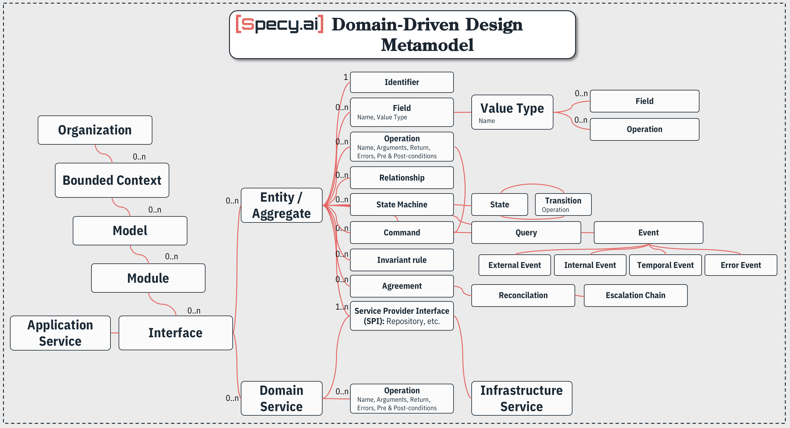
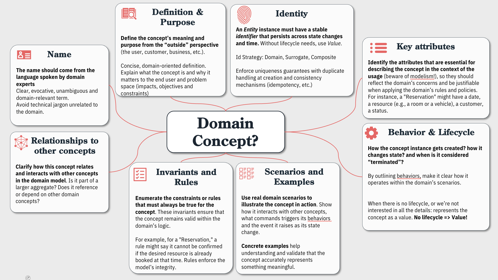
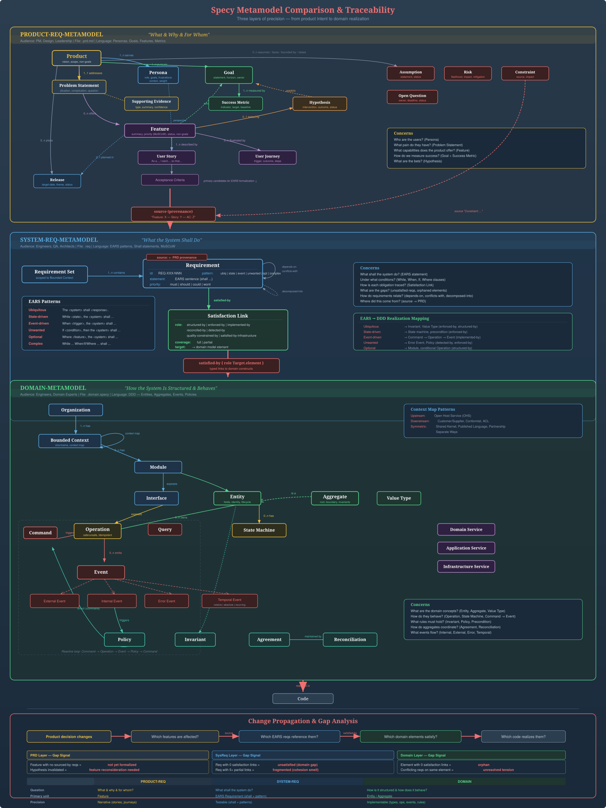
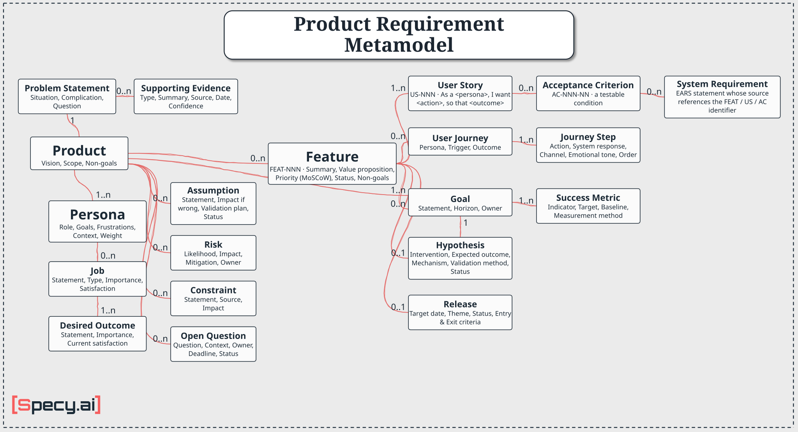
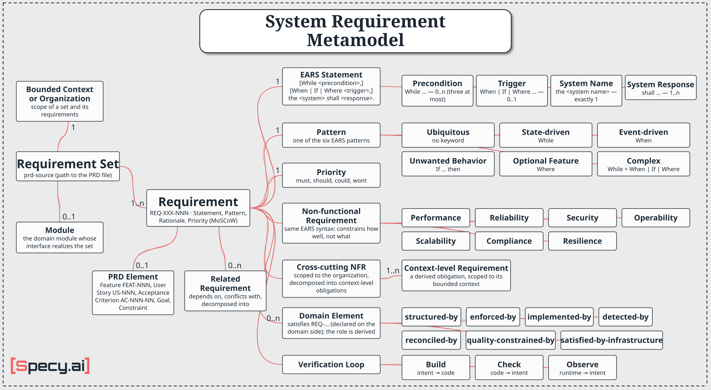
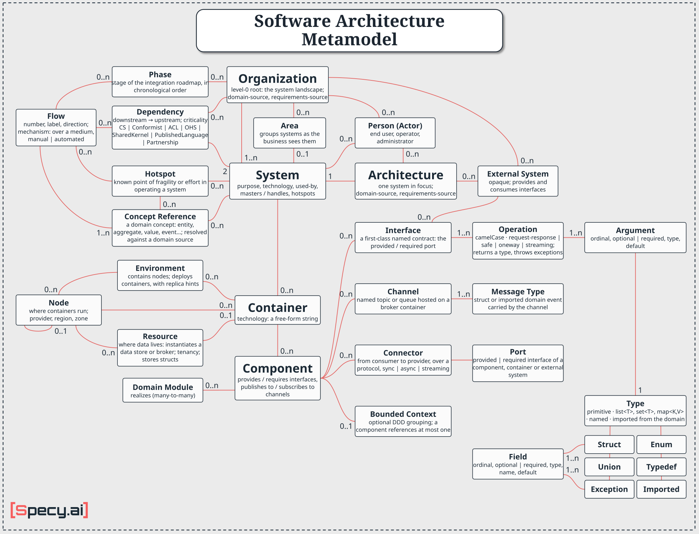

> **The most critical aspect of software is the domain concepts it handles. Specy explicitly defines and structures these concepts to transform them directly into code.**

[](./LICENSE)
[](https://github.com/specy-ai/skills)
[](#skills)
[](#contributing)



Specy is a Domain-Driven Design toolkit that ships as a **Claude Code plugin** (`specy`). Its agent skills work across four structured DSLs:

- **`.prd`** — product requirements (the *why* and *what*)
- **`.sysreq`** — system requirements in EARS syntax (the formal *what*)
- **`.domain`** — the domain model in DDD notation (the *how*)
- **`.arch`** — the software architecture in a C4-inspired notation (the *with what*: systems, containers, components, contracts)

A companion parser/CLI additionally renders a `.domain` model to **JSON, YAML, or Markdown**.

## Why Specy?

**Domain knowledge is the asset. Code is a derivation.**
Domain knowledge — concepts, their relationships, their structure, behavior, lifecycle, rules, etc. — is the real asset; Yet, most of this knowledge remains trapped in people's heads or scattered across a fragmented codebase. As a result, critical intent evaporates during rewrites, and AI-assisted changes quietly drift away from the original design.



Specy fixes this by making domain knowledge **explicit, comprehensive, traceable, and executable.** Engineered for scale and carefully crafted by humans, [Specy’s meta-model](https://github.com/specy-ai/skills/blob/main/src/metamodels/DOMAIN-METAMODEL.md) provides the structural depth required to seamlessly map large, highly complex, and reactive software systems.

### The Bi-Directional Chain of Truth
Specy captures the structure, behavior, and interactions of your software in a unified model. Define it once, and every element stays linked along a continuous, bi-directional pipeline:
Product Vision (.prd) ⇄ Testable Requirements (.sysreq) ⇄ Domain Model (.domain) ⇄ Software Architecture (.arch) ⇄ Generated Code
Because the chain works both ways, your code always reflects your intent, and your documentation never goes out of date.

### Specy vs. Raw LLM Prompts
Why not just prompt your way through development? Because prompts are ephemeral and unverifiable. A Specy model is a rigorous, durable engineering artifact. It gives you the power to:
•	Version & Diff: Track changes to your business logic just like code.
•	Prevent AI Drift: Ground AI generation within strict, verifiable domain boundaries.
•	Regenerate & Recover: Seamlessly spin up clean code from your models, or reverse-engineer clean models out of legacy code.

## Quick start

```bash
git clone https://github.com/specy-ai/skills.git specy && cd specy
./src/skills/build.sh          # build the `specy` plugin → dist/
./install-skills-for-user.sh   # install into ~/.claude/skills/specy
```

Then, in Claude Code:

```
specy:prd-design          # capture product requirements from an idea or brief
specy:domain-design       # model a domain from requirements or prose
specy:architecture-design # design a C4-inspired architecture (.arch) from a .sysreq + .domain
specy:domain-build-code   # generate code (Java/Spring, TS/NestJS, Clojure) from a .domain
specy:domain-extract-from-code   # reverse-engineer a .domain from an existing codebase
specy:synth-design        # a synthetic-data scenario (.synth) from prose: "give me a bad quarter"
specy:domain-build-fixtures      # certified synthetic data in a project's tests (dbt, Java, TS, Clojure)
```

Full options in [Setup](#setup); browse complete models in [`examples/`](./examples).

## See it work

A few lines of `.domain` …

```
value Slug {
  value : String
  invariant "max-length" { value.length <= 30 }
}

entity ShortLink {
  id : ShortLinkId
  slug : Slug
  status : LinkStatus
}
```

… become idiomatic code via `specy:domain-build-code` (Java/Spring shown):

```java
public record Slug(String value) {                 // immutable value, validated at construction
    public Slug {
        if (value.length() > 30)
            throw new IllegalArgumentException("A slug must not exceed 30 characters");
    }
}

public final class ShortLink {                      // aggregate root — no public setters
    private final ShortLinkId id;
    private Slug slug;
    private LinkStatus status;
    // state changes only through domain operations; satisfies traceability carried as annotations
}
```

The same model can also be rendered to JSON/YAML/Markdown, explored conversationally, or kept in sync with code — see [Skills](#skills).

## Table of Contents

- [Skills](#skills)
- [Two Approaches](#two-approaches)
- [Metamodels](#metamodels)
- [Folder Structure](#folder-structure)
- [Prerequisites](#prerequisites)
- [Setup](#setup)
- [Usage](#usage)
- [LSP Server](#lsp-server)
- [Contributing](#contributing)

## Skills

Specy ships as a single Claude Code plugin — **`specy`** — providing 13 AI-assisted skills: 12 **core**
skills named after their input→output artefact, plus 1 **auxiliary** skill. Each is invoked as
`specy:<name>`.

| Skill | Input | Output |
|---|---|---|
| `specy:prd-design` | product idea / brief / prose | `.prd` |
| `specy:sysreq-design` | `.prd` / business rules / prose | `.sysreq` (EARS) |
| `specy:sysreq-extract-from-code` | codebase | `.sysreq` (EARS) |
| `specy:domain-design` | `.sysreq` / `.prd` / prose | `.domain` |
| `specy:domain-build-code` | `.domain` + target stack | source code |
| `specy:domain-extract-from-code` | codebase | `.domain` (+ refactoring report) |
| `specy:domain-refactor` | extracted `.domain` (+ refactoring report) | `.refactored.domain` + rationale |
| `specy:architecture-design` | `.sysreq` (incl. NFRs) / `.domain` / prose | `.arch` |
| `specy:architecture-build-code` | `.arch` + stack-binding artifact | source code (scaffolding) |
| `specy:architecture-extract-from-code` | codebase, or several systems | `.arch` per system (+ level-0 `organization` file) |
| `specy:synth-design` | `.domain` + prose ("a bad quarter") | `.synth` scenario (+ a certified dataset) |
| `specy:domain-build-fixtures` | `.domain` + `.synth` + project | fixtures, certificate tests, `fixtures.report` |
| `specy:domain-dialogue` *(aux)* | `.domain` | — (read-only conversation) |

### `specy:prd-design` — Product Requirements

**Input:** a product idea, brief, or business context in prose. **Output:** a `.prd` file.

Guides creation of a `.prd` file. Interactive 7-phase conversation (Problem & Vision, Personas & Jobs,
Goals & Metrics, Evidence & Hypotheses, Features & Stories, Risks & Constraints, Journeys & Releases),
or one-shot from a brief.

### `specy:sysreq-design` — System Requirements

**Input:** a `.prd`, business rules, or prose. **Output:** a `.sysreq` file (EARS).

Formalizes testable system requirements in EARS syntax. Interactive 4-phase (Context, Functional
Requirements, NFR Discovery, Cross-Requirement Analysis), or one-shot from a `.prd` with
feature-to-requirement mapping and gap analysis.

### `specy:sysreq-extract-from-code` — Requirements from Code

**Input:** a codebase. **Output:** a `.sysreq` file (EARS) per bounded context.

Reverse-engineers what the code *actually does* into testable EARS requirements (bottom-up). For a
domain model from code instead, use `specy:domain-extract-from-code`.

### `specy:domain-design` — Domain Modeling

**Input:** a `.sysreq`, `.prd`, or prose description of business logic. **Output:** a `.domain` file.

Builds a DDD model. Interactive 7-phase conversation (Bounded Contexts, Entities/Aggregates/Values,
Operations/Commands/Events, State Machines, Invariants/Reactions/Properties, Services, Traceability)
with DDD quality challenges, or one-shot from `.sysreq`/`.prd` with requirement traceability.

### `specy:domain-build-code` — Code Generation

**Input:** a `.domain` model + a target stack. **Output:** idiomatic source code for every building block.

Generates a hexagonal source tree from a domain model — mapping entities, value types, aggregates,
commands, queries, events, operations, reactions, invariants, repositories, and domain/application/
infrastructure services to a chosen stack (**Java/Spring, TypeScript/NestJS, Clojure**), preserving
`satisfies` traceability as code annotations. The inverse of `specy:domain-extract-from-code`.

### `specy:domain-extract-from-code` — Domain from Code

**Input:** source code in any supported language. **Output:** a `.domain` file + `specy/refactoring.report` + `specy/.meta.json`.

Reverse-engineers source code into a `.domain` model and produces DDD refactoring recommendations.
Creation / incremental (`git diff` + `.meta.json`) / targeted modes; stack-specific heuristics for
Java/Spring, TypeScript/NestJS, Clojure; test-aware enrichment.

### `specy:domain-refactor` — Redesign an Extracted Model

**Input:** an extracted `specy/<domain>.domain` (+ optional `specy/refactoring.report`). **Output:** `specy/<domain>.refactored.domain` + `specy/<domain>.refactor-rationale.md`.

Redesigns a reverse-engineered model **from first principles** into a proper DDD model: re-derives
entities, value types, aggregates, and behaviour from the business problem while preserving the
ubiquitous language, and fixes the extracted model's design smells (anemic/god entities, primitive
obsession, flag-driven illegal states, generic events, missing temporal/error paths). The bridge from
`domain-extract-from-code` (faithful but flawed) to a clean target model. Maps every change to the smell
it resolves and flags rules a domain expert should confirm.

### `specy:architecture-design` — Software Architecture

**Input:** a `.sysreq` (incl. NFRs) and/or a `.domain`, or prose; for a landscape, interview notes or an integration inventory. **Output:** a `.arch` file.

Designs a C4-inspired architecture that `satisfies` the requirements and `realizes` the domain model.
Interactive 9-phase conversation (Landscape, System Context, Containers, Components, Contracts,
Ports & Connectors, Channels, Deployment, Traceability), or one-shot from `.sysreq` + `.domain`. At
level 0 it maps an organization's system landscape — systems, what each one masters, dependencies,
flows — with or without a domain model; a context map between bounded contexts is `specy:domain-design`.

### `specy:architecture-build-code` — Architecture Scaffolding

**Input:** a `.arch` model + a stack-binding artifact. **Output:** stack-specific scaffolding (the C4 level-4 replacement).

Generates one runnable module per container, service classes per component, interface stubs from the
Thrift-typed contracts, port wiring from connectors, and publish/subscribe glue from channels, for
**Java/Spring, TypeScript/NestJS, Clojure**. Operation bodies are stubs that delegate to the business
logic `specy:domain-build-code` generates. Accepts a level-0 `organization` file (scaffolds each detailed
system, nothing for black boxes); without a stack binding it proposes a default one. The inverse of
`specy:architecture-extract-from-code`.

### `specy:architecture-extract-from-code` — Architecture from Code

**Input:** a codebase, or several systems (repositories, a monorepo, or single-system `.arch` files). **Output:** a `.arch` file per system + `.meta.json` + notes report; for several systems, one level-0 `organization` file.

Reverse-engineers the architecture from source: containers and components, their provided/required
interfaces and typed contracts, channels, external systems, connectors with protocol + style, the
deployment view, and the `realizes` bridge to domain modules when a `.domain` exists. From several
systems it also recovers level 0 — dependencies and flows backed by integration code; `masters`,
patterns and criticality only where evidenced. Stack-specific heuristics for Java/Spring,
TypeScript/NestJS, Clojure. For business entities from code, use `specy:domain-extract-from-code`.

### `specy:synth-design` — Synthetic-Data Scenarios

**Input:** a `.domain` + prose saying what the data should look like. **Output:** a `.synth` scenario
that synthy checks as sound, and on request a dataset synthy generates and certifies.

Reads the model (entities, cardinalities, machines, preconditions, bounds), turns "a bad quarter" or
"a holiday peak" into figures (a revenue curve, a lifecycle mix, a payment split), writes the
scenario and runs `synthy check` until it is sound, explaining each conflict with
`synthy explain`. It maps the user's own files as givens, picks a locale, and may write word lists
of single values (wine names, street names) for the model's text fields. It never writes a row: synthy (the `specy-synthy` package) generates them, with a certificate
DuckDB re-verifies.

### `specy:domain-build-fixtures` — Fixtures in a Project

**Input:** a `.domain`, a `.synth` and a project. **Output:** certified fixtures where the project's
tests read them, the certificate as tests of the project's runner, loaders and domain tests, and a
`fixtures.report`.

Exports the data with `synthy export` (dbt seeds and one singular test per certificate question;
test resources for Java/Spring, TypeScript/NestJS and Clojure), wires a DuckDB harness into JUnit,
vitest/jest or clojure.test, writes loaders onto the code `specy:domain-build-code` generated, and
tests that the code refuses the commands synthy proved must be refused. The report maps each
requirement to its fixture files and questions.

### `specy:domain-dialogue` — Domain Exploration *(auxiliary)*

**Input:** existing `.domain` files. **Output:** none — a read-only conversation.

Navigates the domain-model graph (organization → operation clauses), synthesizing, tracing, and
challenging the model without modifying it. Modes: Explorer, Questioner, Confronter, Completer. When a
change is warranted, it points back to `specy:domain-design` to evolve the model.

## Two Approaches

Specy supports two complementary approaches to domain modeling. Both converge on the same artifact — the `.domain` file — and once it exists, the other skills can operate on it (explore, design the architecture, and generate code).

```
     Top-down (greenfield)                Bottom-up (brownfield)

                                          Existing codebase
                                                   │
                                                   ▼
 Business vision                          specy:domain-extract-from-code → .domain
          │                               specy:architecture-extract-from-code → .arch
          ▼                                        │
 specy:prd-design → .prd                  specy:domain-refactor → .refactored.domain
          │                                        │
          ▼                                        ▼
 specy:sysreq-design → .sysreq            specy:domain-dialogue (explore)
          │                                        │
          ▼                                        ▼
 specy:domain-design → .domain ◄────────► specy:domain-design (evolve)
          │                                        │
          ▼                               (implement + re-extract)
 specy:architecture-design → .arch
          │
          ▼
 specy:architecture-build-code → code (scaffolding)
 specy:domain-build-code → code (business logic)
```

### Top-down: from product vision to domain model

Start with *why* (product vision, personas, jobs-to-be-done) and progressively formalize *what* the system should do (testable requirements) then *how* the domain is structured (entities, operations, rules).

1. **`specy:prd-design`** — capture the product vision: problem statement, personas, goals, hypotheses, features, user stories, and releases into a `.prd` file.
2. **`specy:sysreq-design`** — formalize testable system requirements in EARS syntax from the PRD, producing a `.sysreq` file with traceability back to features.
3. **`specy:domain-design`** — build the domain model from requirements: entities, aggregates, commands, events, operations, state machines, invariants, reactions. Each construct traces back to specific requirements via `satisfies`.
4. **`specy:architecture-design`** — design the software architecture that `satisfies` the requirements (NFRs in particular) and `realizes` the domain model: persons and external systems, containers, components with typed interfaces, connectors, channels, and a deployment view, in a `.arch` file. For several systems, a level-0 `organization` file maps the landscape first.
5. **`specy:architecture-build-code`** and **`specy:domain-build-code`** — generate the code: the former scaffolds containers, components, interface stubs and wiring from the `.arch`; the latter generates idiomatic source code for every building block of the `.domain`, for a chosen stack.

This is the **greenfield** path — no code exists yet. Knowledge flows from intent to structure to code.

### Bottom-up: from existing code to explicit knowledge

Start with *what exists* (source code) and extract the implicit business knowledge into an explicit, verifiable model. Then explore it, challenge it, and evolve it.

1. **`specy:domain-extract-from-code`** — reverse-engineer source code into `.domain` files. The extracted model is faithful to the implementation but carries its design debt, and becomes the source of truth for the other skills. (Use **`specy:sysreq-extract-from-code`** to recover EARS requirements from code, and **`specy:architecture-extract-from-code`** to recover the `.arch` — containers, components, contracts, connectors — and, from several codebases, the organization's system landscape.)
2. **`specy:domain-refactor`** — redesign the extracted model from first principles into proper DDD, fixing the smells flagged in `refactoring.report` (anemic/god entities, primitive obsession, flag-driven illegal states, generic events). Produces a `<domain>.refactored.domain` plus a rationale mapping each fix to the smell it resolves — never overwriting the extracted file.
3. **`specy:domain-dialogue`** — explore and question the domain model through conversation. Surface gaps, trace behaviors, challenge assumptions.
4. **`specy:domain-design`** — when a change is needed, evolve the model. **`specy:domain-build-code`** then regenerates the affected code.
5. The developer implements the change, then runs **`specy:domain-extract-from-code`** (incremental) to bring the model back in sync with the code.

This is the **brownfield** path — code already exists. Knowledge flows from implementation to model, and change proposals flow from model back to code.

## Metamodels

Specy organizes business knowledge into four layers, each with its own metamodel, file format, and grammar. Together they form a **traceability chain** from product vision down to the domain model and the software architecture that realizes it.



### Product Requirements (`.prd`)

**Purpose:** Capture the *why* and *what* of a product — the problem, the people, and the intended value — before any solution is designed.

A `.prd` file structures product thinking into traceable concepts: problem statement, personas, jobs-to-be-done, desired outcomes, goals with success metrics, hypotheses, features, user stories, user journeys, risks, assumptions, constraints, open questions, and releases.

**Traceability:** each feature traces to goals and personas; each user story traces to a feature; each release groups features. The PRD feeds into system requirements via feature-to-requirement coverage.



<details>
<summary><b>PRD key concepts</b></summary>

| Concept | Description |
|---------|-------------|
| Problem Statement | The core problem the product addresses, with supporting evidence |
| Persona | An archetype of a user segment, with context and pain points |
| Job | A job-to-be-done (JTBD) — what the persona is trying to accomplish |
| Desired Outcome | What success looks like from the persona's perspective |
| Goal | A measurable business objective tied to success metrics |
| Hypothesis | A testable assumption linking a feature to an expected outcome |
| Feature | A capability the product provides, traceable to goals and personas |
| User Story | A concrete behavior within a feature, with acceptance criteria |
| User Journey | A sequence of steps a persona takes to accomplish a job |
| Release | A time-boxed delivery grouping features by priority (MoSCoW) |

</details>

### System Requirements (`.sysreq`)

**Purpose:** Formalize *what the system shall do* in testable, unambiguous EARS statements — bridging product intent and domain modeling.

A `.sysreq` file contains requirement sets grouped by feature or capability, using the **EARS** (Easy Approach to Requirements Syntax) patterns. Each requirement has a unique ID, a priority (MoSCoW), and traces back to a PRD feature.

**Traceability:** each requirement set links to a PRD feature via `feature-ref`; each requirement has a unique ID (e.g., `REQ-ORD-001`) that domain model constructs reference via `satisfies`.



<details>
<summary><b>EARS patterns &amp; key concepts</b></summary>

| Pattern | Template | When to use |
|---------|----------|-------------|
| Ubiquitous | "The system shall..." | Always-on behavior |
| State-driven | "While [state], the system shall..." | Behavior tied to a system state |
| Event-driven | "When [event], the system shall..." | Behavior triggered by an event |
| Unwanted | "If [condition], then the system shall..." | Error handling, edge cases |
| Optional | "Where [feature], the system shall..." | Feature-gated behavior |
| Complex | Combines two or more patterns | Multi-condition requirements |

| Concept | Description |
|---------|-------------|
| Requirement Set | A group of related requirements, traced to a PRD feature |
| Requirement | A single EARS statement with ID, priority, and rationale |
| NFR (Non-Functional) | Performance, security, availability, scalability requirements |
| Traceability | `prd-source` links to the originating `.prd` file |

</details>

### Domain Model (`.domain`)

**Purpose:** Model the deep business logic — entities, their behaviors, rules, state machines, and cross-aggregate consistency — in a formal DDD notation.

A `.domain` file captures the full domain model for a bounded context: the structural concepts (what exists), the behavioral concepts (what happens), and the properties (what must hold true). It uses a hierarchical structure: `organization > context > module`.

**Traceability:** `requirements-source` links to the `.sysreq` file; individual constructs use `satisfies [REQ-XXX-001]` to trace back to specific requirements.

<details>
<summary><b>Domain key concepts</b></summary>

| Concept | Description |
|---------|-------------|
| Entity | Domain object with identity, mutable state, and lifecycle |
| Aggregate | Group of entities with a root, enforcing integrity boundaries |
| Value | Immutable object defined by its attributes (no identity) |
| Command | Intent to change domain state (input DTO for write operations) |
| Query | Request for current state (safe, idempotent read) |
| Event | Recorded fact: internal, external (from upstream), error, or temporal |
| Operation | Named behavior owned by an entity — command-triggered or event-triggered |
| Precondition | Named guard on an operation (`rejects` with message) |
| Reaction | Reactive rule: listens to an event, issues a command (triggered-by/effects) |
| Invariant | Safety property that must hold after any mutation (with enforcement strategy) |
| Agreement | Cross-aggregate consistency property with reconciliation mechanism |
| State Machine | Named lifecycle with states, transitions, guards, and actions |
| Domain Service | Stateless business logic spanning multiple entities |
| Application Service | Use case orchestrator from presentation layer |
| Infrastructure Service | External system adapter (notifications, payments, storage) |
| Interface | Named surface exposing a subset of operations |

</details>

### Software Architecture (`.arch`)

**Purpose:** Describe *how the software is structured* to realize the domain model and satisfy the system requirements — a C4-inspired model with Thrift-typed contracts, ports and connectors, first-class async channels, and a lightweight deployment view. C4's level 4 (code) is out of scope: code is generated per stack through a separate stack-binding artifact.

A `.arch` file has one of two roots. **`architecture`** describes one system in focus across C4 levels 1–3: the persons and external systems around it, its containers (separately deployable units identified by a free-form technology), the components inside them, the typed interfaces they provide and require, the connectors that wire those ports with a protocol and an interaction style, the channels that carry messages, and the environments containers deploy to. **`organization`** describes a system landscape at level 0: the systems an organization runs, grouped by area, the domain concepts each one masters, the dependencies between them (`A -> B` reads "A depends on B", with context-map patterns and a criticality), and the numbered flows of domain concepts along each dependency, timed by the phases of an integration roadmap. A system of an organization may stay a black box, or be detailed inline or in its own `architecture` file (`detailed-in`).

**Traceability:** `requirements-source` links to the `.sysreq` file and any element can `satisfies [REQ-XXX-001]` (NFRs drive architecture); `domain-source` links to the `.domain` file(s): a system `realizes context`, a component `realizes module "…"`, value types and events are imported with `import value type X from domain` / `import event X from domain`, and level-0 concept references (`masters`, `handles`, `carries`) resolve to domain elements.



<details>
<summary><b>Architecture key concepts</b></summary>

| Concept | Description |
|---------|-------------|
| Organization | Root of a level-0 file: the systems an organization runs, with its areas, phases, persons, external systems and dependencies |
| Area | Grouping of systems as the organization chart sees them (a department); no runtime meaning |
| Phase | Stage of the integration roadmap during which a flow's mechanism holds; declaration order is chronological |
| System (level 0) | A system named after its role, with its product (`technology`), area, users, mastered and handled concepts, hotspots; a black box or detailed in levels 1–3 |
| Dependency | Directed `A -> B`: A depends on B, with context-map patterns (CS, Conformist, ACL, OHS, SharedKernel, PublishedLanguage, Partnership) and a criticality |
| Flow | Numbered exchange along a dependency: the concepts it carries (`X as Y` when translated), its direction, its mechanism (medium, manual/automated), once or per phase |
| Hotspot | Known point of fragility or effort in operating a system; concerns flows (by number) and concepts |
| Concept Reference | A domain type name, optionally qualified by context (`Finance.Invoice`), resolved to exactly one element of the domain sources |
| System | The software system in focus (level 1): contains containers, shared contracts, channels, connectors, environments |
| Person | A human role that interacts with the system — a source or sink of interactions, never a container |
| External System | Opaque system outside the boundary; provides and consumes interfaces, participates in connectors and channels |
| Bounded Context | Optional grouping tag over components — the DDD model boundary projected onto the architecture |
| Container | Separately runnable or deployable unit (level 2), identified by a free-form technology string |
| Component | Logical unit inside a container (level 3): realizes domain modules, provides/requires interfaces, publishes/subscribes to channels |
| Interface / Operation | First-class contract owning its operations: ordinaled typed arguments, a return type, `throws`; style default, `safe`, `oneway`, `streaming` |
| Struct, Enum, Typedef, Union, Exception | Thrift-inspired named types with field ordinals and `optional`/`required` markers; exceptions realize domain error events |
| Connector | Directed wire from a required port to a provided port, `over` a protocol, `sync` / `async` / `streaming` |
| Channel | Named topic or queue on a broker container that `carries` message types (usually imported domain events) |
| Environment | Deployment stage: nodes (provider, region, zone), resources (where data lives, tenancy, stored structs) and `deploy` placements with replicas |

</details>

One system in focus (`architecture` root), trimmed from [`examples/url-shortener/url-shortener.arch`](./examples/url-shortener/url-shortener.arch):

```
architecture Sniplink :: "Sniplink URL-shortening platform — software architecture" {
  domain-source       "url-shortener.domain"
  requirements-source  "url-shortener.sysreq"

  person Publisher :: "A registered user who shortens URLs, manages links, and reads analytics"

  externalSystem GoogleSafeBrowsing
      :: "Google Safe Browsing — external URL threat-intelligence API"
      realizes module "Link Safety Scanning" {
    provides ThreatLookup
  }

  system Sniplink :: "The Sniplink platform: link shortening, redirect, analytics, safety, API"
      satisfies [REQ-NFR-008, REQ-NFR-009, REQ-NFR-020] {

    import value type Slug           from domain
    import event LinkShortened   from domain   // emitted on successful creation

    exception SlugTaken         :: "Requested custom slug is already in use" {
      1: required string requestedSlug
      2: optional string suggestedAlternative
    }

    interface LinkCommands :: "Write side of link lifecycle"
        satisfies [REQ-LNK-001, REQ-LNK-008] {
      createShortLink(1: required DestinationUrl target, 2: optional Slug customSlug)
        returns ShortLinkDTO throws (SlugTaken, UnsafeDestination)
    }

    container EdgeApi :: "Edge HTTP service: link write-side, public API, custom domains"
        technology "Clojure/Ring + Reitit"
        satisfies [REQ-NFR-005, REQ-NFR-008] {
      component LinkController :: "HTTP edge for link lifecycle commands & queries"
          realizes module "Link Shortening", module "Link Management" {
        boundedContext LinkShortening
        provides LinkCommands
        requires SafetyScanning            // must scan before shortening (REQ-LNK-008)
        publishes LinkShortened to linkEvents
      }
    }
    container EventBus    :: "Event broker for first-class async channels" technology "Kafka"

    channel linkEvents on EventBus :: "Link lifecycle + safety-flag fan-out" {
      carries LinkShortened, LinkDeactivated, UrlFlaggedAsUnsafe
    }

    connect LinkController.SafetyScanning -> SafetyScanner over "gRPC" sync
    connect SafetyScanner.ThreatLookup -> GoogleSafeBrowsing.ThreatLookup over "HTTPS/REST" async

    environment production :: "Multi-AZ production deployment" {
      node euWest :: "Primary EU region" provider "AWS" region "eu-west-1" {
        deploy EdgeApi replicas 3
      }
    }
  }
}
```

A system landscape (`organization` root), trimmed from [`examples/retail-media/retail-media.arch`](./examples/retail-media/retail-media.arch), whose concept names resolve against [`retail-media.domain`](./examples/retail-media/retail-media.domain):

```
organization RetailMediaCo
    :: "A retail-media network selling on-site and off-site advertising for a group of retailers" {
  domain-source "retail-media.domain"

  phase Phase1 :: "Go-live of the finance stack; flows without a ready-made connector run on manual files"
  phase Phase2 :: "Most manual steps automated, mostly through APIs"

  area FinanceOffice  :: "Accounting, treasury, supplier spend and group reporting"
  person FinanceStaff     :: "Accountants, treasurers and the group controller"

  externalSystem Banks :: "The company's banks: execute payment files, publish account statements" {
    masters BankStatement
  }

  system ERP :: "Financial accounting, reporting, analysis and tax under local and group accounting standards"
      technology "NetSuite"
      realizes context Finance {
    area FinanceOffice
    used-by FinanceStaff
    masters Customer, Vendor, Item, Invoice, JournalEntry, Payment
    handles BankStatement             // received from CashManagement (flow 6)
    hotspot MonthEndClose
        :: "Until phase 2 the monthly close waits on six manual file imports, and one late export delays it; the payroll journal stays manual after that"
        concerns 1, 2, 3, 6, 16, 18
  }

  dependency ERP -> CRM : ACL, OHS :: "Billing needs the CRM's products, accounts and billing schedule" {
    flow 2 "Accounts" carries Account as Customer {
      phase Phase1 over "CSV file export/import" manual
      phase Phase2 automated            // only known to be automated so far
    }
  }

  dependency CashManagement -> Banks : PublishedLanguage criticality degraded :: "ISO 20022 formats, owned by neither side" {
    flow 10 "Payment files (pain.001)" carries PaymentOrder to Banks over "EBICS" automated
    flow 11 "Account statements (camt.053)" carries BankStatement over "EBICS" automated
  }
}
```

The Navigator in [`ui/`](./ui/README.md) renders an `architecture` file as a foldable C4 diagram and an `organization` file as a landscape of its systems — see `ui/README.md`.

### Synthetic-data scenarios (`.synth`)

**Purpose:** Declare what a generated data set must *add up to* for a domain model — how many rows, which revenue curve, which lifecycle mix, which payment split — so that synthy (the `specy-synthy` package) can generate rows that satisfy both the model and the scenario, and certify the result with questions re-verified in SQL. It is not a fifth knowledge layer but Specy's fourth verification loop: data that conforms to the model and to a declared business picture exists, and a certificate proves it.

A `.synth` file is written *against* one `.domain` (`domain-source`) and never restates it: every entity, field, state machine, state and enum member it names is a reference into the model, resolved by the language server, so an unknown name is red in the editor before any row exists. It holds **populations** (`count` or `per` parent), **outcomes** of six kinds — `curve`, `total`, `share`, `mix`, `rate`, `rollup` — **givens** (reference data supplied rather than generated), a **vocabulary**, **distributions** and generator **options**. Proportions are written as fractions or percentages.

Realism never costs conformance:
- a given (a real catalogue, master data, the instances of an `enum X of ValueType`) maps its file's columns to the model, is checked cell by cell, and flows through unchanged while synthy generates the columns it leaves out;
- a vocabulary picks a locale pack (`intl`, `en`, `fr`, `de`, `es`, `it`, `nl`, `"en-GB"`, or a pack file) and word lists for single text fields, and swapping packs changes text columns only;
- distributions (`uniform`, `lognormal`, `zipf`) shape values (skewed prices, best sellers, regulars) without moving an outcome; the certificate's plausibility section compares them with the data.

Outcomes go beyond single columns:
- a rate's predicate combines atoms with `and`, `or`, `not`;
- a share can be `given` another column (one split per state, say);
- a curve on a `per` population is keyed by its parent's clock.

The behaviour comes from the model: synthy walks each state machine and honours its transitions' preconditions, including those that read another row. A reaction's command follows its trigger and a temporal event fires on its deadline. Commands that must be refused are generated as negative fixtures.

**Traceability:** an outcome that states a business figure names the requirement that states it with `satisfies [REQ-…]`; the generator copies the identifiers onto the facts it writes, so a passing certificate question is evidence for that requirement.

<details>
<summary><b>Example — <code>examples/ecommerce/v2/orders.synth</code></b></summary>

```
scenario OrdersH1_2025 :: "Six months of e-commerce orders" {
    domain-source "orders.domain"
    seed 42
    horizon 2025-01-01 .. 2025-07-01
    as-of 2025-07-01T00:00:00Z

    populations {
        Customer  count 200
        Order     count 1200
        OrderLine per Order 1..5
        Payment   per Order exactly 1
    }

    outcomes {
        curve monthlyRevenue Order.totalAmount.amount by Order.placedAt per month {
            2025-01: 180000
            2025-02: 195000
        }
        mix Order.OrderLifecycle { delivered: 72%  shipped: 6%  confirmed: 8%  draft: 4%  cancelled: 10% }
        share Payment.method { creditCard: 60%  paypal: 30%  bankTransfer: 10% }
        rollup Order.totalAmount.amount from OrderLine.total.amount
        rate Product.available = true : 90%
    }

    options {
        dwell { draft --> confirmed : 4h  confirmed --> shipped : 2d }
    }
}
```

</details>

The metamodel is [`src/metamodels/SYNTH-METAMODEL.md`](./src/metamodels/SYNTH-METAMODEL.md), the grammar [`src/grammars/synth.ebnf`](./src/grammars/synth.ebnf). The same scenario is also stored as **JSON or YAML**, for programs and language models: one document in three encodings, described by the JSON Schema [`src/schemas/synth-scenario.schema.json`](./src/schemas/synth-scenario.schema.json) and converted between them without loss (metamodel, [Storage formats](./src/metamodels/SYNTH-METAMODEL.md#storage-formats)). `specy-synth parse -f json|yaml` writes that document from a `.synth` (see [LSP Server](#lsp-server)).

## Folder Structure

```
specy-skill/
├── src/                          # All source material (humans edit here)
│   ├── skills/                   # Skill templates and build system
│   │   ├── build.sh              # Assembles dist/ plugin (skills + manifest) from templates
│   │   ├── plugin/               # Plugin manifest template (plugin.json)
│   │   ├── prd-design/           # specy:prd-design source
│   │   ├── sysreq-design/        # specy:sysreq-design source
│   │   ├── sysreq-extract-from-code/   # specy:sysreq-extract-from-code source
│   │   ├── domain-design/        # specy:domain-design source
│   │   ├── domain-build-code/    # specy:domain-build-code source (main.md + heuristics/)
│   │   ├── domain-extract-from-code/   # specy:domain-extract-from-code source (main.md + heuristics/)
│   │   ├── domain-refactor/      # specy:domain-refactor source
│   │   ├── architecture-design/  # specy:architecture-design source
│   │   ├── architecture-build-code/    # specy:architecture-build-code source (main.md + heuristics/)
│   │   ├── architecture-extract-from-code/   # specy:architecture-extract-from-code source (main.md + heuristics/)
│   │   ├── synth-design/         # specy:synth-design source
│   │   ├── domain-build-fixtures/      # specy:domain-build-fixtures source (main.md + heuristics/)
│   │   └── domain-dialogue/      # specy:domain-dialogue source (auxiliary)
│   ├── grammars/                 # Canonical EBNF grammars (source of truth)
│   │   ├── domain.ebnf           # Domain model grammar (.domain)
│   │   ├── architecture.ebnf     # Software architecture grammar (.arch)
│   │   ├── prd.ebnf              # Product requirements grammar (.prd)
│   │   ├── sysreq.ebnf           # System requirements grammar (.sysreq)
│   │   └── synth.ebnf            # Synthetic-data scenario grammar (.synth)
│   ├── metamodels/               # Metamodel documentation
│   │   ├── DOMAIN-METAMODEL.md
│   │   ├── SOFTWARE-ARCHITECTURE-METAMODEL.md
│   │   ├── PRODUCT-REQ-METAMODEL.md
│   │   ├── SYSTEM-REQ-METAMODEL.md
│   │   └── SYNTH-METAMODEL.md    # .synth scenarios written against a .domain
│   ├── schemas/                  # JSON Schemas of the documents stored as JSON or YAML
│   │   └── synth-scenario.schema.json  # a scenario as JSON or YAML (the .synth document)
│   ├── tree-sitters/             # Tree-sitter parser generators + build script
│   │   ├── build.sh
│   │   ├── tree-sitter-specy-domain/
│   │   ├── tree-sitter-specy-architecture/
│   │   ├── tree-sitter-specy-prd/
│   │   ├── tree-sitter-specy-sysreq/
│   │   └── tree-sitter-specy-synth/
│   └── langium/                  # Langium-based LSP server + parser CLIs
│       └── specy-domain/         # .domain and .synth languages (specy-domain, specy-synth)
│
├── dist/                         # Built `specy` plugin (generated — do not edit)
│   ├── .claude-plugin/
│   │   └── plugin.json           # Plugin manifest
│   └── skills/
│       ├── prd-design/           # SKILL.md + grammar/ + references/
│       ├── sysreq-design/        # SKILL.md + grammar/ + references/
│       ├── sysreq-extract-from-code/   # SKILL.md + grammar/ + references/
│       ├── domain-design/        # SKILL.md + grammar/ + references/
│       ├── domain-build-code/    # SKILL.md + heuristics/ + grammar/ + references/
│       ├── domain-extract-from-code/   # SKILL.md + heuristics/ + grammars/
│       ├── domain-refactor/      # SKILL.md + grammar/ + references/
│       ├── architecture-design/  # SKILL.md + grammar/ + references/
│       ├── architecture-build-code/    # SKILL.md + heuristics/ + grammar/ + references/
│       ├── architecture-extract-from-code/   # SKILL.md + heuristics/ + grammars/ + references/
│       ├── synth-design/         # SKILL.md + grammar/ + references/ + examples/
│       ├── domain-build-fixtures/      # SKILL.md + heuristics/ + references/
│       └── domain-dialogue/      # SKILL.md (auxiliary)
│
├── examples/                     # Example Specy projects
│   ├── business-loan/            # .prd, .sysreq, .domain
│   ├── url-shortener/            # .prd, .sysreq, .domain, .arch (one system in focus)
│   ├── retail-media/             # Organization landscape: .domain + level-0 .arch
│   ├── ride-now/                 # Multi-context ride-sharing (.prd, .sysreq, .domain)
│   ├── ecommerce/                # Orders example (.domain, v2 format)
│   └── uber-old/                 # Legacy ride-sharing example (superseded by ride-now)
│
├── ui/                           # Navigator: browses .domain / .sysreq files, renders .arch diagrams (see ui/README.md)
│
├── hooks/                        # Git hooks
│   └── pre-commit                # Ensures dist/ stays in sync with src/
│
├── install-skills-for-user.sh    # Symlinks the built plugin (dist/) to ~/.claude/skills/specy
├── parse-domain.sh               # Render a .domain to JSON / YAML / Markdown
├── LICENSE                       # MIT
├── VISION.md                     # Specy thesis and design philosophy
├── CORE_TEAM.md                  # Core review panel
└── VISION_TEAM.md                # Vision review panel
```

### Key directories

**`src/`** — Everything humans edit. Skill templates, grammars, metamodels, and tree-sitter sources. The `src/skills/build.sh` script assembles the final `SKILL.md` files from templates using `<!-- include: path -->` and `<!-- include-code: lang path -->` markers.

**`dist/`** — Build output produced by `src/skills/build.sh`: the `specy` plugin (`.claude-plugin/plugin.json` + `skills/<name>/SKILL.md`) plus runtime files (heuristics, grammars, metamodel references) bundled inside each skill. Never edit files here directly — they are overwritten on each build.

**`src/grammars/`** — Canonical EBNF grammars for each file format. The build script copies them into the relevant `dist/skills/` directories.

**`src/metamodels/`** — Prose documentation of each metamodel. These describe the concepts, relationships, and constraints that the grammars formalize. Copied to `dist/` as runtime references for skills that need them.

**`src/tree-sitters/`** — Tree-sitter parser generators for Specy file formats. Used for syntax highlighting, parsing validation, and tooling integration.

**`src/langium/`** — [Langium](https://langium.org/)-based LSP server and parser CLIs for the `.domain` and `.synth` DSLs, on one shared service set so a scenario's references resolve into its domain model. Provides editor diagnostics, AST access, `specy-domain parse` (JSON, YAML, Markdown) and `specy-synth parse` (the scenario document synthy reads, as JSON or YAML). See [LSP Server](#lsp-server) below.

**`examples/`** — Complete example projects demonstrating Specy files across different domains. `url-shortener/` carries a single-system `.arch`; `retail-media/` an `organization` landscape with its `.domain`.

**`ui/`** — The Specy Navigator, a static HTML prototype that browses `.domain` and `.sysreq` files and renders a `.arch` file as a foldable C4 diagram (or, for an `organization` file, as a landscape of its systems). See [`ui/README.md`](./ui/README.md).

## Prerequisites

You need one of the following AI coding assistants:

- [Claude Code](https://docs.anthropic.com/en/docs/claude-code) (Anthropic) — first-class, installs as the `specy` plugin
- [GitHub Copilot](https://docs.github.com/en/copilot) with custom skills support
- [Vibe](https://docs.mistral.ai/vibe/) (Mistral)

## Setup

### Claude Code (recommended)

Build the plugin, then install it (symlinks the built plugin into `~/.claude/skills/specy`, where
Claude Code auto-loads it as the `specy@skills-dir` plugin):

```bash
./src/skills/build.sh          # assemble dist/ (the specy plugin)
./install-skills-for-user.sh   # symlink dist/ → ~/.claude/skills/specy
```

Skills then invoke as `specy:<name>` — e.g. `specy:domain-design`, `specy:domain-build-code`.

Alternatives:

```bash
claude --plugin-dir ./dist                                  # load for one session, no install
claude plugin marketplace add . && claude plugin install specy   # via the local marketplace
```

### Manual setup (any assistant)

The built plugin lives in `dist/` (a `.claude-plugin/plugin.json` + `skills/<name>/SKILL.md` tree).
For assistants without plugin support, each skill is a self-contained directory under `dist/skills/`
that can be symlinked individually:

```bash
ln -sf /path/to/specy/dist/skills/domain-design ~/.claude/skills/domain-design
```

## Usage

The typical workflow follows the traceability chain:

```
1. specy:prd-design                     Define the product (problem, personas, features)        → .prd
2. specy:sysreq-design                  Formalize testable requirements from the PRD            → .sysreq
3. specy:domain-design                  Build the domain model from requirements                → .domain
4. specy:architecture-design            Design the architecture from requirements + domain      → .arch
5. specy:architecture-build-code        Scaffold containers, components, contracts from .arch   → code
   specy:domain-build-code              Generate code from the domain model                     → code
   specy:domain-extract-from-code       Reverse-engineer a domain model from existing code      → .domain
   specy:architecture-extract-from-code Reverse-engineer the architecture from existing code    → .arch
   specy:domain-refactor                Redesign an extracted model from first principles       → .refactored.domain
   specy:sysreq-extract-from-code       Recover EARS requirements from existing code            → .sysreq
6. specy:synth-design                   Declare synthetic data the domain allows                → .synth (+ data)
   specy:domain-build-fixtures          Put certified data into a project's tests               → fixtures + tests
7. specy:domain-dialogue                Explore and question a domain model                     → (read-only)
```

| Workflow | What to run |
|----------|-------------|
| Define product requirements | `specy:prd-design` |
| Formalize system requirements (EARS) | `specy:sysreq-design` after the PRD is done |
| Build a domain model from requirements | `specy:domain-design` after requirements are written |
| Design the software architecture | `specy:architecture-design` after the domain model (and NFRs) are written |
| Scaffold code from an architecture model | `specy:architecture-build-code` with a stack-binding artifact |
| Generate code from a domain model | `specy:domain-build-code` with a target stack |
| Reverse-engineer a domain model from code | `specy:domain-extract-from-code` in your project |
| Reverse-engineer the architecture from code | `specy:architecture-extract-from-code` in your project, or across several repositories |
| Redesign an extracted model into proper DDD | `specy:domain-refactor` on the extracted `.domain` |
| Recover EARS requirements from code | `specy:sysreq-extract-from-code` in your project |
| Declare synthetic data for a domain | `specy:synth-design` with the `.domain` and what the data should show |
| Seed a project's tests with certified data | `specy:domain-build-fixtures` after the code is generated |
| Explore and question a domain model | `specy:domain-dialogue` in a project with `*.domain` files |

In your target project, Specy files live under `specy/` at the project root.

## LSP Server

Specy ships a [Langium](https://langium.org/)-based Language Server and parser CLIs for `.domain` and `.synth` files, located in `src/langium/specy-domain/`. The two languages run on one shared service set, so a `.synth` scenario resolves its dot-paths into the `.domain` it names with `domain-source`. It provides:

- **Editor integration** — diagnostics, syntax validation, and AST navigation via LSP (VS Code extension entrypoint in `src/extension/main.ts`; neovim through `vim.lsp.config`). In a `.synth` file, an unknown entity, field, state or enum member is an error naming what was expected and the closest candidate; completion after `Order.totalAmount.` offers the fields of `Money`; editing the `.domain` revalidates the scenarios written against it.
- **Parser CLI** (`specy-domain`) — parses a `.domain` file into **JSON, YAML, or Markdown**, or validates it from the command line. Since 1.1.0 the JSON output opens with a `parser: { name, version }` header, so consumers such as synthy can pin the shape they understand.
- **Scenario CLI** (`specy-synth`) — parses a `.synth` file against its `domain-source` into the scenario document synthy reads, as JSON or YAML (`specy-synth parse orders.synth -f yaml`), or validates it (`specy-synth validate`). Semantic rules carry the conflict code synthy would raise (`SYN-E006`, …), so a scenario clean in the editor is one the generator accepts.

### Build

```bash
./src/langium/specy-domain/build.sh
```

The script runs `npm install`, generates the Langium artifacts for both languages, compiles TypeScript to `out/`, smoke-tests the CLIs against the bundled examples (every `.domain`, and `orders.synth` against `orders.domain`), and runs the test suite.

### Parse a `.domain` file

The easiest entry point is the `parse-domain.sh` wrapper at the repository root. It builds the parser on first use and works from any directory:

```bash
# Markdown documentation
./parse-domain.sh examples/ecommerce/v2/orders.domain -f markdown

# Clean YAML model
./parse-domain.sh examples/ecommerce/v2/orders.domain -f yaml > orders.yaml

# Pretty-printed JSON (default format is json)
./parse-domain.sh examples/ecommerce/v2/orders.domain --pretty
```

| Flag | Description |
|------|-------------|
| `-f, --format <fmt>` | `json` (default), `yaml`, or `markdown` |
| `--pretty` | Pretty-print JSON output |
| `--raw` | Emit the faithful Langium AST (with `$type` discriminators) instead of the clean domain model — `json`/`yaml` only |

`json` and `yaml` share a **clean domain model**: Langium internals are stripped and definitions are grouped by kind (`entities`, `values`, `enums`, `commands`, `queries`, `events`, `services`, `reactions`, …) under their owning context/module. `markdown` renders the same model as a documentation-style document (heading hierarchy, field tables, operation summaries). Pass `--raw` when you need the verbatim AST.

Under the hood the wrapper calls the CLI directly, which you can also invoke from `src/langium/specy-domain/`:

```bash
node out/cli/index.js parse ../../../examples/ecommerce/v2/orders.domain -f markdown
node out/cli/index.js parse ../../../examples/ecommerce/v2/orders.domain -f json | jq '.definitions.entities[].name'
```

Example JSON output (truncated) for `examples/ecommerce/v2/orders.domain`:

```json
{
  "modules": [
    { "name": "Order", "dependencies": ["Shipping"] }
  ],
  "definitions": {
    "enums": [
      { "kind": "enum", "name": "OrderStatus", "values": ["draft", "confirmed", "shipped", "delivered", "cancelled"] }
    ],
    "entities": [
      {
        "kind": "entity",
        "name": "Customer",
        "description": "A customer who places orders",
        "identity": { "name": "id", "type": "UUID" },
        "fields": [
          { "name": "name", "type": "string", "constraints": ["minLength(1)", "maxLength(100)"] },
          { "name": "email", "type": "EmailAddress", "constraints": ["unique"] }
        ]
      }
    ]
  }
}
```

Parse errors are written to `stderr` with `line:column` locations, and the process exits non-zero.

### Parse a `.synth` scenario

```bash
cd src/langium/specy-domain
node out/cli/synth.js validate ../../../examples/ecommerce/v2/orders.synth
node out/cli/synth.js parse ../../../examples/ecommerce/v2/orders.synth --pretty > orders.synth.json
node out/cli/synth.js parse ../../../examples/ecommerce/v2/orders.synth -f yaml > orders.synth.yaml
```

| Flag | Description |
|------|-------------|
| `-f, --format <fmt>` | `json` (default) or `yaml`: the same document, valid against `src/schemas/synth-scenario.schema.json` |
| `--pretty` | Pretty-print JSON output |
| `--strict` | Exit 1 on any error instead of emitting best-effort output |

The scenario names its model with `domain-source "orders.domain"`, resolved relative to the `.synth` file; the CLI loads both and links every reference. `parse` emits best-effort output on errors unless `--strict` is given. The output opens with `$schema` and `parser: { name: "specy-synth", version }` and carries `domain`, so synthy can run `synthy check orders.synth.yaml` without a second argument. YAML follows the 1.2 core schema and quotes every scalar a YAML 1.1 reader would retype (dates, `yes`, `on`); keys come in the canonical order synthy's writer also uses, so both tools write the same bytes.

A broken scenario reads like compiler output:

```
orders.synth:12:21 [error SYN-E005] 'totalAmout' is not a member of entity Order. Did you mean 'totalAmount'?
orders.synth:19:9  [error SYN-E008] Mix of Order.OrderLifecycle sum to 0.9, not 1. Make them sum to 1, or omit a member to leave it at 0.
orders.synth:23:46 [error SYN-E013] Payment must be declared per Order for the rollup to hold.
```

### Validate a `.domain` file

```bash
node out/cli/index.js validate ../../../examples/ecommerce/v2/orders.domain
```

Emits one `path:line:col [severity] message` line per diagnostic. Exits `0` when there are no errors (warnings allowed), `1` otherwise — suitable for CI gates.

## Contributing

Specy is built in the open — issues and PRs are welcome. The design philosophy lives in [VISION.md](./VISION.md); if it resonates, a ⭐ helps.

### Setup

After cloning, configure the git hooks:

```bash
git config core.hooksPath hooks/
```

### Editing skills

Always edit files in `src/skills/`, never the generated files in `dist/`.

After editing, regenerate:

```bash
src/skills/build.sh                          # Build all skills
src/skills/build.sh domain-extract-from-code # Build a single skill
```

The pre-commit hook blocks commits if `dist/` is out of date with `src/`.

### Building tree-sitter parsers

```bash
./src/tree-sitters/build.sh
```

Requires `tree-sitter` CLI. Builds all four grammars (`prd`, `sysreq`, `domain`, `architecture`) and runs smoke tests against every example file in `examples/`, including the two `.arch` files.
