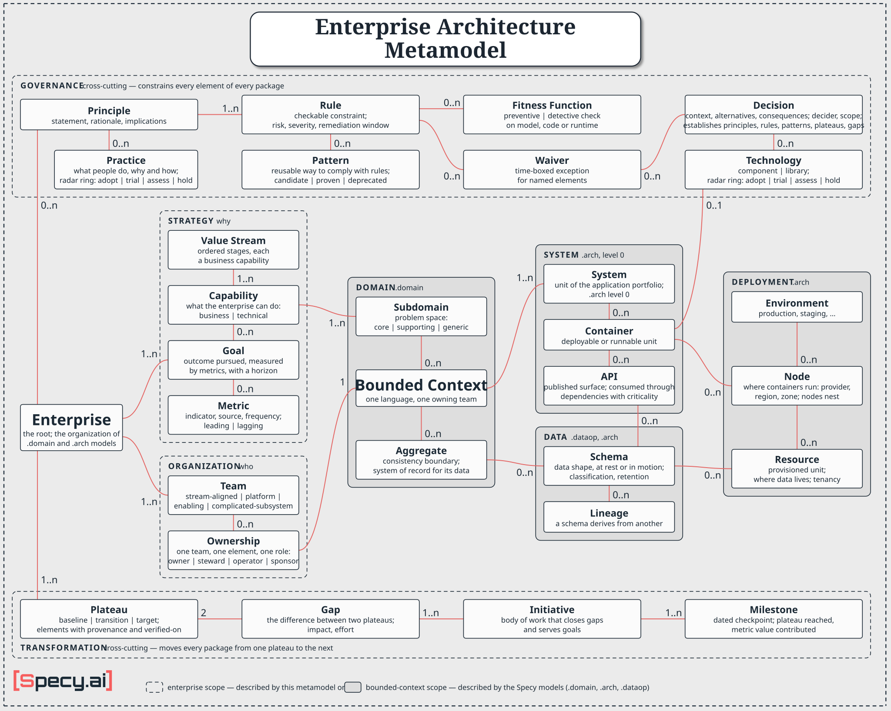

# Enterprise Architecture metamodel

> **Status: draft.** This file proposes the concepts and relations of an enterprise-scope layer for Specy. There is no grammar, no file extension and no skill for this layer yet; the concrete syntax in the [worked example](#worked-example) is illustrative only. The bounded-context concepts it references do have a grammar: subdomains, bounded contexts and aggregates in `.domain`; systems, dependencies, flows, phases, containers, nodes and resources in `.arch`; structs and the lineage between them in `.dataop`. The points still to settle are listed under [Open questions](#open-questions).



This file defines an **enterprise architecture** metamodel: the concepts needed to describe an organization's architecture as a whole — why it invests, who owns what, which rules hold everywhere, and how the landscape moves from its current state to a target one.

The other Specy metamodels each describe one thing in depth: a product (`.prd`), its requirements (`.sysreq`), a domain (`.domain`), a system (`.arch`), its data and operations (`.dataop`). They all work at **bounded-context scope** — one model, one language, one team. The level 0 of `.arch` is the one exception: it maps an organization's landscape — its systems, what each one masters, how they depend on each other — but says nothing of why they exist or who answers for them. None of them answers the questions that only appear when there are many of them: which capability does this context serve, which team owns it, is it allowed to call that other system synchronously, what replaces it next year.

This metamodel adds that **enterprise scope**, and it does so by wrapping the existing models instead of re-describing them. It defines eight packages:

| Package | Scope | Answers | Concepts | Described by |
|---|---|---|---|---|
| [Strategy](#strategy-package) | enterprise | why, and how it is measured | Goal, Capability, Value Stream, Metric | this metamodel |
| [Organization](#organization-package) | enterprise | who | Team, Ownership | this metamodel |
| [Domain](#domain-package) | bounded context | what the business knows | Subdomain, Bounded Context, Aggregate | `.domain` |
| [System](#system-package) | bounded context | what runs | System, Container, API | `.arch`: level 0 for systems, dependencies and flows; levels 2–3 for containers and interfaces |
| [Data](#data-package) | bounded context | what is stored and where it flows | Schema, Lineage | `.dataop` structs and their `derives from` clauses; `.arch` types |
| [Deployment](#deployment-package) | bounded context | where it runs | Environment, Node, Resource | `.arch` deployment view |
| [Governance](#governance-package) | enterprise, cross-cutting | what must hold, and how to comply | Principle, Rule, Fitness Function, Pattern, Decision, Waiver, Technology, Practice | this metamodel |
| [Transformation](#transformation-package) | enterprise, cross-cutting | what changes, and when | Plateau, Gap, Initiative, Milestone | this metamodel |

Strategy, Organization, Domain, System, Data and Deployment form a chain: strategy and organization give a bounded context its reason and its owner, the domain is realized by systems and data, and both are deployed. Governance and Transformation are **cross-cutting**: a rule may constrain an element of any package, and a plateau may contain elements of every package. With the [Enterprise](#enterprise) root, the eight packages hold thirty concepts.

It borrows from ArchiMate (goal, principle, capability, value stream, plateau, gap), from Team Topologies (team types), from evolutionary architecture (fitness functions), from architecture decision records, from the Thoughtworks Technology Radar (its four rings), and from Tanusree McCabe's *Fundamentals of Enterprise Architecture* (patterns and technology standards, the anatomy of a decision, metrics). It is deliberately smaller than any of them (see [Mapping to ArchiMate](#mapping-to-archimate)).

## What this metamodel is NOT

- It is **not a second description** of the domain, the systems or the data. The four bounded-context packages name concepts that live in `.domain`, `.arch` and `.dataop` files — subdomains, the level-0 landscape, lineage, nodes and resources included — and add only what is visible from above: the capability an element serves, who owns and funds it, how sensitive its data is, which rules constrain it and which plateaus it exists in. An enterprise model that restates an aggregate's fields, or lists a system the level-0 landscape does not have, is wrong by construction.
- It is **not ArchiMate**. There is no business-process layer (a value stream is an ordered list of capabilities, not a process), no actor/role/collaboration vocabulary and no generic relationship algebra (serving, triggering, flow, access…). Each relation here is named and has one meaning.
- It is **not a portfolio or project-management tool**. An initiative carries what explains an architecture change — the gaps it closes, the goals it serves, its milestones — not budgets, staffing or task breakdowns.
- It is **not an org chart**. Teams appear as owners of things; reporting lines, headcount and people are out of scope.
- It is **not a CMDB**. Deployment records the placement and residency facts that architecture rules need; it does not inventory every running instance.

## Convention

Every concept in this metamodel carries a **name**, a **description** and a **metadata** map (arbitrary key/value pairs). These attributes are implicit and not repeated in each definition below.

The metadata map is for what has no attribute yet. An attribute that a rule reads must be declared on its concept, with a stated purpose, the lifecycle of its value and the quality rules it obeys: attributes are what governance runs on, and a rule over a free key checks a value nobody has agreed to keep current.

**Scopes.** A concept is either *enterprise scope* (it exists once for the whole enterprise and spans bounded contexts) or *bounded-context scope* (it belongs to one bounded context and is described by a Specy model). The package table above gives the scope of each package.

**Element references.** Governance and Transformation concepts, and Ownership, point at "an element": any named concept of any package, including the concepts of the Specy models behind the bounded-context packages (a module, a component, a connector, a struct, a level-0 dependency or flow). Wherever a relation below says *element*, it means such a reference. An element is referenced, never copied.

**Implicit correspondence by naming.** As in the Data & Operation metamodel, an enterprise-scope reference to a bounded-context-scope concept is resolved by name: the enterprise is the `organization` of the `.domain` files and of the level-0 `.arch` file, a subdomain or a bounded context named here is the `.domain` one of the same name, a system is the level-0 `system` of the same name, a plateau is the level-0 `phase` of the same name when there is one, and a technology is the one a `technology` string names. An explicit reference is needed only when names diverge.

**Stable identifiers.** The governance and transformation concepts that other artifacts cite carry unique, stable identifiers, following the rule already used for features and requirements — the identifier never changes when the element is renamed, and is never reused:

- **Principle**: `PRIN-NNN`
- **Rule**: `RULE-NNN`
- **Pattern**: `PAT-NNN`
- **Practice**: `PRAC-NNN`
- **Decision**: `ADR-NNN`
- **Waiver**: `WVR-NNN`
- **Initiative**: `INIT-NNN`

## Enterprise

The root of the model: the organization whose architecture is described. It is the same thing as the `organization` of the domain metamodel and the level-0 `organization` of the architecture metamodel, under the same name, seen with everything that surrounds its bounded contexts and its systems. Each correspondence holds once its file exists: a landscape is often mapped before any domain model, and a capability map before either.

Relations:
- 0..1 "corresponds to" relation with a domain organization (`.domain`)
- 0..1 "corresponds to" relation with an architecture organization (the level-0 `.arch` file)
- 1..n "pursues" relation with goals
- 1..n "has" relation with capabilities (the capability map)
- 0..n "has" relation with value streams
- 0..n "tracks" relation with metrics
- 1..n "is staffed by" relation with teams
- 0..n "adopts" relation with principles
- 0..n "publishes" relation with patterns
- 0..n "catalogues" relation with technologies
- 0..n "adopts" relation with practices (whatever their ring)
- 0..n "records" relation with decisions
- 1..n "is described by" relation with plateaus (at least the baseline)

---

## Strategy package

Strategy states what the enterprise is trying to achieve, what it must be able to do to get there, and how it will know it has. It is the reason every other element exists: an element that no capability and no goal can be traced to is a candidate for retirement.

### Goal

An outcome the enterprise pursues, stated so that its achievement can be judged.

A goal has:
- **statement**: the outcome, measurable (e.g. "Decide 80% of consumer loan applications in under ten minutes").
- **horizon**: the date or period by which it should be met.

A goal is measured by one or more [metrics](#metric), each with the **target value** to reach by the horizon. Read as an OKR, the goal is the objective and each metric with its target is a key result. A goal refined into sub-goals may be judged through them; any other goal has at least one measure.

An enterprise goal is not a product goal. The `goal` of the PRD metamodel belongs to one product; an enterprise goal spans products, and product goals **contribute to** it. The two keep the same word — the enterprise one is ArchiMate's goal — and are told apart by scope: an enterprise goal is declared in the enterprise model, a product goal in a `.prd`.

Relations:
- 0..n "refined into" relation with sub-goals
- 0..n "measured by" relation with metrics, each with a target value (a key result)
- 0..n "requires" relation with capabilities (the capabilities whose creation or improvement the goal depends on)
- 0..n "contributed to by" relation with product goals (`.prd`)
- 0..n "served by" relation with initiatives

### Capability

Something the enterprise is able to do, named independently of how it is done, by whom and with which system ("Underwrite a loan", "Collect a payment"). Capabilities are stable: teams reorganize and systems are replaced far more often than a capability appears or disappears. That stability is what makes the capability map the anchor for everything below it.

A capability has a **kind**:

| Kind | Meaning | Realized by |
|---|---|---|
| `business` | something the business does, for its customers or for itself ("Underwrite a loan") | subdomains: the parts of the problem space it falls in |
| `technical` | something the platform does for the systems ("Deliver a notification", "Scale a service automatically", "Monitor a service") | systems, directly — typically systems owned by a `platform` team |

A technical capability is not an area of the business, so it does not pass through a subdomain. Recording it as a `generic` subdomain would hide what a platform team provides behind the vocabulary of the problem space.

Capabilities decompose into a tree, usually two or three levels deep, and a capability decomposes into capabilities of its own kind. Only leaf capabilities are realized.

Relations:
- 0..n "decomposes into" relation with sub-capabilities (of the same kind)
- 1..n "realized by" relation with subdomains (leaf `business` capabilities)
- 0..n "realized by" relation with systems (leaf `technical` capabilities; at least one in the target plateau)
- 0..n "stage of" relation with value streams
- 0..n "required by" relation with goals
- 0..1 "owned by" relation with a team (through an ownership)

### Value Stream

An optional, ordered sequence of **stages** through which the enterprise delivers an outcome, from what starts it to what it delivers ("Lend to a consumer": verify identity, underwrite, disburse). Each stage is a business capability. A value stream names capabilities, never systems, teams or activities: it is not a process model — no actors, no branches, no tasks — and stays at the level of ArchiMate's value stream.

It earns its place by explaining **why** two bounded contexts integrate. When the subdomains of two contexts realize successive stages of one value stream, something has to pass from one to the other; when they share no value stream, a dependency between them needs another reason. The value stream says that two contexts must integrate; the context map and the level-0 dependencies say how.

A value stream has:
- **trigger**: what starts it (a request, an event).
- **outcome**: what it delivers at its end.

Relations:
- 1..n "has stage" relation with business capabilities, in order (a capability may be a stage of several value streams)
- 0..1 "owned by" relation with a team (through an ownership)

### Metric

An indicator the enterprise measures, defined once so that a goal, a milestone and a fitness function that speak of the same number use the same definition. A metric is not a target: the target belongs to the element that uses the metric.

A metric has:
- **indicator**: what is measured, precisely enough to be computed ("share of consumer applications decided in under 10 minutes, per calendar month").
- **unit**: `%`, minutes, a count, an amount.
- **data source**: where the values come from — a system, a schema, a report, a survey.
- **frequency**: how often a value is taken.
- **kind**: `leading` (moves before the outcome, early enough to act on) or `lagging` (records the outcome once it has happened).

Relations:
- 0..n "measures" relation with goals, each with a target value (a key result)
- 0..n "contributed to by" relation with milestones, each with the value expected at the milestone's date
- 0..n "evaluated by" relation with fitness functions, each with a threshold
- 1..1 "owned by" relation with a team (through an ownership)

---

## Organization package

Organization records who is accountable for what. It exists because of Conway's law: the structure of the systems follows the structure of the teams, so a model that knows one and not the other cannot explain the architecture it describes.

### Team

A long-lived group of people that owns elements. A team has a **type**, taken from Team Topologies:

| Type | Purpose |
|---|---|
| `stream-aligned` | delivers a flow of business change for one or a few bounded contexts |
| `platform` | provides internal services that other teams consume |
| `enabling` | helps other teams acquire a capability, then steps back |
| `complicated-subsystem` | owns a part that needs rare specialist knowledge |

Teams may declare how they interact (`collaboration`, `x-as-a-service`, `facilitating`). The interaction mode between two teams should agree with the context-map pattern between the bounded contexts they own, which the level-0 dependencies between their systems repeat: a Partnership or Shared Kernel implies collaboration; an Open Host Service or Customer/Supplier relation implies x-as-a-service.

Relations:
- 0..n "holds" relation with ownerships
- 0..n "follows" relation with practices
- 0..1 "part of" relation with a parent team
- 0..n "interacts with" relation with other teams, characterized by an interaction mode

### Ownership

A first-class link between **one team**, **one element** and **one role**. It is a concept of its own, not an attribute of the element, for three reasons: it changes on its own schedule, it belongs to a plateau like any other element (the owner in the target state may differ from today's), and its absence or duplication is something a rule can detect.

| Role | Meaning |
|---|---|
| `owner` | accountable for the element: decides its evolution, answers for its defects |
| `sponsor` | funds the element: pays for building and running it |
| `steward` | accountable for the meaning and quality of data (schemas) |
| `operator` | runs the element in production |

Governance and strategy elements are owned like any other. The owner of a rule triages its findings, the owner of a fitness function keeps it running and its verdicts trustworthy, the owner of a pattern, a practice or a technology keeps it current, the owner of a metric answers for its values; a decision is usually owned by the team that decided it.

Constraints:
- An element has at most one `owner`. Two owners is a finding; so is none, for the kinds of element a rule declares must be owned.
- A bounded context shall have exactly one owner, and a team should own few of them: a context split between teams loses its single language, and a team spread over many contexts exceeds its cognitive load.
- Every rule and every fitness function shall have exactly one owner, the team that triages its findings. A `must` rule nobody owns blocks changes with no one to appeal to; a `should` rule nobody owns produces reports nobody reads.
- Every practice, and every technology on the `adopt` ring, shall have exactly one owner: the team that keeps the entry current, answers the teams that rely on it, and proposes when it changes ring. A default choice nobody owns is one nobody upgrades.

Relations:
- 1..1 "held by" relation with a team
- 1..1 "of" relation with an element (capability, value stream, metric, subdomain, bounded context, system, container, API, schema, resource, principle, rule, fitness function, pattern, decision, technology, practice, initiative)

---

## Domain package

The domain package is described by `.domain` files (see DOMAIN-METAMODEL.md), subdomains included. The enterprise view adds the links that tie the problem-space partition and the bounded contexts to strategy, to a team and to the systems that realize them.

### Subdomain

An area of the problem space: a part of the business the enterprise has to deal with, whether or not software exists for it. A subdomain is classified by its strategic value:

| Classification | Meaning | Typical consequence |
|---|---|---|
| `core` | where the enterprise differentiates | built in-house, by the strongest team, modeled in depth |
| `supporting` | necessary, specific to the business, not differentiating | built simply, or outsourced |
| `generic` | a problem every business has | bought or adopted, not built |

A subdomain is problem space; a bounded context is solution space. The ideal is one bounded context per subdomain. Several contexts for one subdomain usually records history (a legacy system next to its replacement); one context covering several subdomains is a context that has grown too large. A subdomain may also have no context at all — a part of the business run on spreadsheets, by hand, or in a product nobody has modeled — which is why it is modeled by zero or more contexts. Only the target plateau requires a context, and only for a `core` or `supporting` subdomain: a `generic` one may stay served by a bought product, reached through an SPI interface.

*Declared in `.domain`, at organization scope (`subdomain Underwriting core`); each bounded context names the subdomains it `models`. The `.domain` file never refers to capabilities: a capability states the subdomains that realize it, here.*

Relations:
- 1..n "realizes" relation with business capabilities (stated on the capability, with `realized-by`)
- 0..n "modeled by" relation with bounded contexts (at least one in the target plateau, unless `generic`)
- 0..1 "owned by" relation with a team (through an ownership)

### Bounded Context

The bounded context of the domain metamodel: the boundary within which one model and one language hold. It is the pivot of this metamodel — the place where enterprise scope meets the Specy models. Everything above explains why it exists and who owns it; everything below is how it is built, stored and run.

Relations visible at enterprise scope (the context's modules and its context map stay in the `.domain` file and are not repeated here):
- 1..n "models" relation with subdomains (`models`, in the `.domain` file)
- 1..1 "owned by" relation with a team (through an ownership)
- 1..n "realized by" relation with systems (each system's level-0 `realizes context`, in the `.arch`; inside a detailed system, components realize the context's modules)
- 0..n "contains" relation with aggregates (through its modules)

### Aggregate

The aggregate of the domain metamodel: a cluster of entities with one root that enforces their integrity. At enterprise scope it matters for one reason: it is the **system of record** for its data. Every schema should trace back, directly or through lineage, to the one aggregate that masters it, and through it to the one system that masters the aggregate at level 0 (see [System](#system)).

Relations added at enterprise scope:
- 0..n "mastered as" relation with schemas

---

## System package

The system package is a view over level 0 of the architecture metamodel (see SOFTWARE-ARCHITECTURE-METAMODEL.md, Level 0 — Organization): the systems of the organization's `.arch` file, the dependencies between them and the flows that detail those dependencies. Containers and interfaces come from the systems that are detailed, inline or in their own `.arch` file. The set of all level-0 systems is the enterprise's application portfolio. This layer adds who owns and funds each system, the technical capabilities it realizes and the plateaus it exists in; it never keeps a second list of systems.

### System

The level-0 `system` of the architecture metamodel: one software system, named for its role, with its purpose, its product when it is bought, the bounded contexts it `realizes` and the concepts it `masters` and `handles`. At enterprise scope it is the unit of the application portfolio — what is funded, owned, replaced and retired. A black-box system, one nobody details, is a full member of the portfolio; it simply has no containers.

A system realizes bounded contexts, technical capabilities, or both. One that realizes neither cannot be traced to any capability, and is a candidate for retirement.

**System of record, at two grains.** Level 0 states it per system: a system `masters` the main entities and aggregates it is the source of truth for. The [aggregate](#aggregate) states it per schema: an aggregate is "mastered as" the schemas that persist it. The two agree: a schema mastered by an aggregate of a context the system realizes persists a concept that system masters, whether or not its `masters` list names it — that list holds the main concepts, not an inventory. When several systems realize the context, the aggregate's system of record is the one whose `masters` names it; a second system mastering it is the two-masters defect that level 0 already reports.

**Platform** is derived, not declared: a platform is a system owned by a `platform` team whose `enterprise`-visible APIs are consumed by two or more other systems. Where a platform separates its tenants is a property of its resources (see [Resource](#resource)).

Relations (the first four are stated in the `.arch`):
- 0..n "realizes" relation with bounded contexts (`realizes context`)
- 0..n "contains" relation with containers (none for a black box)
- 0..n "depends on" relation with systems and external systems (level-0 dependencies, each with its criticality when stated)
- 0..1 "uses" relation with a technology (a bought system's product, by name)
- 0..n "realizes" relation with technical capabilities
- 1..1 "owned by" relation with a team (through an ownership)
- 0..1 "funded by" relation with a team (through an ownership with the role `sponsor`)

### Container

The `container` of the architecture metamodel, in a system detailed at level 2: a separately runnable or deployable unit with a free-form technology. It is the unit that deployment places, and its technology resolves by name to the [technology](#technology) catalogue.

Relations added at enterprise scope:
- 0..n "provides" relation with APIs
- 0..n "deployed on" relation with nodes (`deploy`, inside a node of the `.arch` deployment view; a container deployed directly in an environment is unplaced)
- 0..1 "uses" relation with a technology (by name)

### API

The published surface of a system: the interfaces its containers and components **provide** to other systems, and the channels on which it publishes messages. Inside one `.arch` file these are `interface` and `channel`; the enterprise view gathers those that cross a system boundary, because they are what other teams depend on. A black-box system's API is an interface it provides as a whole.

An API has a **visibility**: `internal` (same bounded context), `enterprise` (other contexts), or `public` (partners, customers).

Who consumes an API is not declared on it. Level 0 already says which system depends on which, and each flow along a dependency says what it carries and over what; inside a detailed system, the connectors that realize those flows name the interface or channel they use. An API's consumers are the downstream systems of the dependencies whose flows or connectors use it. Each of those dependencies may state a **criticality** — `critical` (the downstream system is down when the upstream one is), `degraded` (it keeps running with reduced service) or `tolerant` (no user-visible impact) — and the consumption has the criticality of its dependency. A dependency without one is unstated, which is not the same as `tolerant`.

Level 0 already computes a system's **blast radius** from it: the systems that go down with it are those that depend on it, directly or transitively, through `critical` dependencies. The enterprise view reads the same walk through ownership, to name the teams whose systems go down, and extends it along the `degraded` dependencies to the systems that lose service. Unstated dependencies on the way make the answer incomplete, and are listed with it.

Relations:
- 1..1 "provided by" relation with a container, or with its system when the system is a black box
- 0..n "exposes" relation with schemas
- 0..n "consumed by" relation with systems (derived from level-0 dependencies and their flows; each consumption has its dependency's criticality)

---

## Data package

The data package is described by `.dataop` files (structs and the lineage between them — see DATA-OPERATION-METAMODEL.md) and by the type system of `.arch` files (structs and channel message types). This layer adds what is decided enterprise-wide: classification, retention and stewardship.

### Schema

A named data shape, at rest (a `.dataop` struct, persisted) or in motion (an `.arch` struct or message type, exchanged).

A schema has, at enterprise scope:
- **classification**: `public`, `internal`, `confidential` or `personal` — the sensitivity of what it holds.
- **retention**: how long instances may be kept, when a rule or a regulation says so.

Relations:
- 0..1 "masters" relation from an aggregate (the system of record; absent for a derived schema)
- 0..n "derived from" relation with schemas (through lineage)
- 0..n "exposed by" relation with APIs
- 0..n "stored in" relation with resources
- 0..1 "stewarded by" relation with a team (through an ownership)

### Lineage

A directed **derives from** link between two schemas, possibly in different bounded contexts, optionally naming what carries the data: a level-0 flow, an API or a channel. Lineage is how the model knows that a reporting table, a search index or a read-only entity in another context is a copy of something mastered elsewhere.

The domain metamodel's read-only entity (master data) is one case of lineage, declared from the consumer's side; lineage states the same fact enterprise-wide and across more than one hop.

Level 0 states the same kind of fact one grain up. A flow that `carries Account as Customer` says that the ERP's customers are made from the CRM's accounts; a lineage says which schema derives from which, and may name that flow as its carrier. The flow is the precedent, the lineage the detail: a lineage between schemas of two different systems that no flow between those systems explains is reported.

Lineage enables three checks: impact (which schemas are affected when a source changes), classification (a schema derived from `personal` data is `personal` unless a decision says otherwise), and provenance (a schema with no aggregate and no lineage has no system of record).

*Authored in `.dataop`, as a `derives from` clause in the body of the derived struct: `derives from { catalog.Product via "flow 12" }`. A source in another model is declared as an `external struct` and named by its qualified name; `via` names the carrier, a level-0 flow cited by its number (a string) or an interface or a channel of the architecture model (a name); under `observed`, `?` marks a candidate source. The link is between structs: field-by-field mapping is out of scope.*

Relations:
- 1..1 "from" relation with a source schema
- 1..1 "to" relation with a derived schema
- 0..1 "carried by" relation with a level-0 flow or an API

---

## Deployment package

The deployment view of the architecture metamodel holds all three concepts: environments, the nodes inside them, the resources on those nodes and the containers deployed on each (see SOFTWARE-ARCHITECTURE-METAMODEL.md, Deployment view). The enterprise view describes none of them again; it reads them for the facts that enterprise rules need — where things run, where data physically is, and which technologies they use.

### Environment

The `environment` of the architecture metamodel: a named stage in which containers are deployed (`production`, `staging`).

Relations:
- 0..n "contains" relation with nodes
- 0..n "deploys" relation with containers placed on no node (unplaced)

### Node

A place where containers run inside an environment: a region, a cluster, a virtual machine, a serverless runtime. Nodes nest (a cluster in a region). A node carries the facts placement rules test: provider, region, zone.

*Authored in the `.arch` deployment view, inside an environment: `node euWest provider "AWS" region "eu-west-1" { node apps { deploy Api replicas 3 } }`.*

Relations:
- 1..1 "belongs to" relation with an environment
- 0..1 "nested in" relation with a parent node
- 0..n "hosts" relation with containers (with a replica count)
- 0..n "provides" relation with resources

### Resource

A provisioned unit of infrastructure on a node that containers consume: a database instance, a topic, a bucket, a cache, a secret store. It is where data physically lives, which makes it the element residency and retention rules are checked against. A `.arch` container whose technology is a data store or a broker is the logical element; the resource is its provisioned instance in one environment.

A resource has a **technology** (the provisioned product, with the same free-form meaning as a container's) and a **tenancy**: `dedicated` to one system, or `shared` with other systems. Tenancy is where a platform's tenant boundary lives, and what isolation and residency rules test.

*Authored in the `.arch` deployment view, inside a node: `resource decisionDb instantiates DecisionStore technology "PostgreSQL" tenancy dedicated { stores CreditDecision }`.*

Relations:
- 1..1 "provided by" relation with a node
- 0..1 "instantiates" relation with a container (a data store or broker)
- 0..n "stores" relation with schemas
- 0..1 "uses" relation with a technology (by name)

---

## Governance package

Governance states what must hold across the enterprise, gives teams the means to comply, and keeps track of where it does not hold. It is cross-cutting: its concepts point at elements of every package.

The eight concepts form one loop with two halves. On the **enforcement** side, a principle says what the enterprise wants, rules make it checkable, and fitness functions check them. On the **enablement** side, patterns show the approved structure for an element to satisfy a rule, practices the way of working for a team to satisfy it, and technologies the components and libraries systems are built with; technologies and practices together make up the technology radar. A waiver records an accepted violation, and a decision is where principles, rules, patterns, practices, radar rings and waivers come from. A principle without a rule cannot be checked; a rule without a principle has no stated reason; a `must` rule with no fitness function is not checked, and one with neither a proven pattern nor a practice on the `adopt` ring is a mandate that leaves each team to invent its own way to comply.

**The technology radar** is a view, not a concept: every technology and every practice, grouped by category and placed on a ring, each with its success criteria. Its purpose is that teams build with the same technologies and work in the same ways, that every entry is actually used and has a visible effect, and that the whole keeps up with the state of the art. Technologies and practices share its vocabulary: a free-text **category** (data stores, messaging, delivery, observability…); **success criteria**, the measurable outcome expected of the entry, which every entry states — it makes explicit why the entry is there, instead of leaving it to the hype; and a **ring**:

| Ring | Meaning |
|---|---|
| `adopt` | the default choice, in production use |
| `trial` | under evaluation in at least one initiative |
| `assess` | worth exploring; no production use |
| `hold` | no new use is started; names its successor when one exists |

A ring changes only by a decision. A radar whose rings never move goes stale — it records what was true when it was written — and trials keep it moving: a `trial` entry moves to `adopt` or to `hold` once its initiatives have measured it against its success criteria. A rule may read the ring like any declared attribute: "every container's technology is `adopt`, or `trial` under an initiative, or its use is waived".

### Principle

A durable statement of how the enterprise intends to build and run its architecture. Principles are few and change rarely.

A principle has:
- **statement**: the principle itself, in one sentence.
- **rationale**: why the enterprise holds it.
- **implications**: what it costs and what it rules out.

Relations:
- 1..n "refined into" relation with rules
- 0..n "served by" relation with practices
- 0..1 "established by" relation with a decision
- 0..1 "owned by" relation with a team (through an ownership)

### Rule

A constraint that can be checked against elements. Where a principle says "bounded contexts are loosely coupled", a rule says "no synchronous connector joins components of two different bounded contexts".

A rule has:
- **statement**: the constraint.
- **applies to**: the kind of element it constrains, with an optional filter (connectors whose ends are in different bounded contexts; schemas classified `personal`).
- **severity**: `must` (a violation blocks) or `should` (a violation is reported).
- **risk**: what the rule mitigates — the outage, cost, exposure or lock-in that follows when it is broken. It is the rule's reason, stated where a team meets it: a rule whose risk nobody perceives is the first one worked around.
- **remediation window**: how long a violation may stand, once found, before it is fixed or covered by a waiver. The enterprise sets a default window per severity, shorter for `must` than for `should`, and a rule may override the default of its own severity.

Severity stays two-valued. Proportionality — a consequence commensurate with the risk — comes from the risk and the window, not from more levels.

Several constraints already written as "shall" in the other metamodels are natural rules: the domain metamodel says interactions between bounded contexts should be asynchronous; a rule lets an enterprise make that a `must`, or waive it for one integration.

A rule is not a non-functional requirement. An organization-scoped NFR (see SYSTEM-REQ-METAMODEL.md) states a quality the running platform shall have, and is decomposed into context-level requirements. A rule constrains the shape of the architecture itself. A rule may exist because of an NFR, and then names it.

Relations:
- 1..n "refines" relation with principles
- 0..n "verified by" relation with fitness functions
- 0..n "enabled by" relation with patterns and practices
- 0..n "waived by" relation with waivers
- 0..n "derives from" relation with organization-scoped requirements (`.sysreq`)
- 0..1 "established by" relation with a decision
- 1..1 "owned by" relation with a team (through an ownership)

### Fitness Function

A repeatable, objective check of a rule. It has:
- **target**: what it inspects — `model` (the Specy files), `code`, or `runtime`.
- **mode**: `automated` or `manual` (a review, an audit).
- **kind**: `preventive` (stops a violation from getting in: a check that blocks a merge or a deployment) or `detective` (finds a violation already there: a scheduled scan, a runtime probe, an audit).
- **enforcement point**: where in the delivery path it runs — `plan`, `design`, `build`, `test`, `deploy` or `run`.
- **trigger**: when it runs — on change, on a schedule, continuously.
- **verdict**: per element, `pass`, `fail` or `waived`.

A fitness function may also evaluate a [metric](#metric) against a threshold — a deployment frequency, a share of asynchronous integrations — instead of answering a yes-or-no query.

Model-level fitness functions are where the Specy models pay off: because `.domain`, `.arch` and `.dataop` files are machine-readable, many rules are queries over them and need neither the code nor a running system. "Every required port is wired", "no sync connector crosses a bounded context", "every `personal` schema has a steward" are all of that kind. They run at `design`, before any code exists, and are preventive by nature.

The earlier and the more preventive the check, the cheaper the violation. The shares of preventive and of automated fitness functions measure the governance itself, and are metrics like any other.

A `must` rule with no fitness function is a finding: nothing checks it.

Relations:
- 1..n "verifies" relation with rules
- 0..1 "evaluates" relation with a metric, against a threshold
- 1..1 "owned by" relation with a team (through an ownership)

### Pattern

A reusable way to comply: the approved *how* that goes with a rule's *what*. Where RULE-007 forbids synchronous connectors between bounded contexts, a pattern shows how two contexts integrate asynchronously — events published on a channel through an outbox, a read-only entity on the consumer's side — and points at the template that sets it up.

A pattern has:
- **problem**: the situation it addresses, in the words a team would use to look for it.
- **solution**: the approach, its structure and its trade-offs.
- **form**: `design` (a described approach), `implementation` (a library or module to use as is), `reference-implementation` (a working example to copy) or `template` (a generator or starter that produces the solution).
- **status**: `candidate` (proposed, not yet applied), `proven` (applied by at least one element) or `deprecated` (not to be applied any more; existing applications are migrated).

A pattern is enablement, not enforcement, and is not itself a rule. Only when there is truly one acceptable way to solve a problem does a rule require the pattern, and it then says so in its statement.

Relations:
- 1..n "enables" relation with rules
- 0..n "applied by" relation with elements (the systems, containers, connectors or schemas built with it; at least one for a `proven` pattern)
- 1..1 "owned by" relation with a team (through an ownership)
- 0..1 "established by" relation with a decision

### Decision

An architecture decision record. It has:
- **context**: the forces at play.
- **alternatives**: the options considered, each with the factors for and against it — its trade-offs. The option chosen is one of them. A record with no alternative is an assertion, not a decision.
- **decision**: the option chosen, and why it wins over the others.
- **consequences**: what follows, good and bad.
- **status**: `proposed`, `accepted`, `rejected` or `superseded`.
- **date**.
- **scope**: `team`, `org-unit` or `enterprise` — how far its effects reach.
- **reversibility**: `one-way` (costly or impossible to undo: a data store, a vendor contract, a public API) or `two-way` (cheap to reverse if it proves wrong).

One team is accountable for a decision and **decides** it. Other teams are **consulted** before it is taken, or **informed** once it is.

**Scope and escalation.** Scope can be derived from the owners of the elements the decision affects: it is `team` when one team owns them all, `org-unit` when their owners share an ancestor team (through "part of"), and `enterprise` when they share none. The deciding team must be the single owner, for a `team` decision, or a common ancestor of all the owners otherwise; an `enterprise` decision is taken by a team with no parent, an architecture board or its equivalent. A decision decided below that level exceeds its decider's reach and escalates, and a declared scope narrower than the derived one is reported.

**Reversibility** sets how much a decision must show: a `one-way` decision lists at least two alternatives and consults at least one team besides the decider.

**Accepted technical debt** is recorded as an element, never only as free text in the consequences: debt that violates a rule is a [waiver](#waiver) the decision grants, and debt that departs from the target is a [gap](#gap) the decision establishes. Either way it has an expiry or an initiative, and a check can find it.

Decisions are how governance and transformation change: a principle, a rule, a pattern, a practice or a technology's ring is established, amended or retired by a decision, every waiver is granted by one, and a target plateau or a gap may be established by one — a target architecture is the sum of the decisions that shape it. Principles and rules that predate the decision log simply have no establishing decision.

Relations:
- 0..n "establishes" relation with principles, rules, patterns, technologies, practices, plateaus and gaps
- 0..n "grants" relation with waivers
- 0..n "affects" relation with elements
- 0..1 "supersedes" relation with a decision
- 1..1 "decided by" relation with a team
- 0..n "consulted" relation with teams
- 0..n "informed" relation with teams
- 0..1 "owned by" relation with a team (through an ownership; usually the deciding team)

### Waiver

An approved, time-boxed exception: named elements are allowed to violate one rule until a date. It has:
- **justification**: why the violation is accepted.
- **expiry**: the date after which the violation counts again. Mandatory — a waiver without an expiry is a rule change, and belongs in a decision.
- **remediation**: how the violation will be removed.

Relations:
- 1..1 "exempts from" relation with a rule
- 1..n "applies to" relation with elements
- 1..1 "granted by" relation with a decision
- 0..1 "remediated by" relation with an initiative

### Technology

An entry of the enterprise's technology catalogue: a concrete software element available to build systems with — a product, a framework, a managed service, a language or runtime — with an interface and documentation, and the enterprise's position on it. It is reference data — the enterprise's technology standards, and half of its [technology radar](#governance-package) — and it gives the free-form technology strings of the other models something to be checked against.

A technology has:
- **name**: the product, written as the models write it (`"PostgreSQL"`, `"Kafka"`). A container's or a resource's `technology`, and a bought system's, resolves to the technology of the same name when one exists; a string that resolves to nothing is unknown to the catalogue, which a rule may report. The name is the technology's identity: it carries no stable identifier.
- **kind**: `component` (a stateful software element that runs somewhere and exposes an interface — an API, a UI, a CLI — and a service level: an identity provider, a database), `library` (a software element built into its user's own code, with a programmatic interface: a circuit-breaker library) or `runtime` (a language or execution platform that containers are built with and run on: Java 21, Node.js 22, a Kubernetes distribution). Approved languages are the oldest technology standard, and a container's `technology` string names one as often as a product.
- **category**: its group on the radar — data stores, messaging, delivery, observability…
- **ring**: the enterprise's position on it — `adopt`, `trial`, `assess` or `hold`.
- **success criteria**: the measurable outcome expected of it ("events reach their consumers in under a second at p99").

A code snippet or a template is not a technology: it is a [pattern](#pattern)'s `form`, `reference-implementation` or `template`. A library that a pattern of form `implementation` ships is catalogued as well, as a technology of kind `library`.

The rings take over the champion/challenger vocabulary of technology standards: `adopt` is the champion, `trial` a challenger under evaluation, and `hold` covers both the deprecated technology and the one never approved. A `hold` technology names its successor when one exists: what its users migrate to.

Relations:
- 0..1 "succeeded by" relation with a technology (what to migrate to, for a `hold` one)
- 0..n "trialled by" relation with initiatives (at least one for a `trial` one)
- 0..1 "established by" relation with a decision (the one that set its current ring)
- 0..n "used by" relation with containers, resources and bought systems (by name)
- 0..n "used by" relation with practices
- 0..1 "owned by" relation with a team (through an ownership; exactly one for an `adopt` one)

### Practice

A way of working that teams follow: what people do, with why they do it — the principles it serves — and how, which its description tells, naming the technologies it relies on when there are any. *Progressive rollout* is one: a release reaches a growing share of users, is watched at each step, and is rolled back automatically when a step fails. *Log level per request* is another: the log level is raised for one request, and carried with it from service to service, instead of for a whole service.

A practice is not a [pattern](#pattern). A pattern is a solution structure that elements apply — the systems, containers, connectors and schemas built with it; a practice is a way of working that teams follow, and no element of the models applies it. Both are enablement, and both enable rules: an outbox makes a connector comply with RULE-007 whatever the team's habits, and progressive rollout makes releases comply with a rule on how they reach users whatever the system's structure.

A practice has:
- **statement**: what people do, in one sentence.
- **category**: its group on the radar — delivery, observability…
- **ring**: `adopt`, `trial`, `assess` or `hold`, with the same meaning as for a technology.
- **success criteria**: the measurable outcome expected of it ("a faulty release reaches under 5% of users before it is rolled back").

A `hold` practice names its successor when one exists: the way of working its teams move to.

Relations:
- 0..n "serves" relation with principles (its why)
- 0..n "enables" relation with rules
- 0..n "uses" relation with technologies (by name)
- 0..n "practised by" relation with teams (each of which "follows" it)
- 0..n "trialled by" relation with initiatives (at least one for a `trial` one)
- 0..1 "succeeded by" relation with a practice (what to move to, for a `hold` one)
- 0..1 "established by" relation with a decision (the one that set its current ring)
- 1..1 "owned by" relation with a team (through an ownership)

---

## Transformation package

Transformation describes change over time. It is cross-cutting: a plateau contains elements of every package, including teams, ownerships and rules.

### Plateau

A state of the architecture that holds for a period. A plateau has a **kind**: `baseline` (what exists now), `target` (where the enterprise wants to be) or `transition` (a stable intermediate state).

A plateau is a selection, not a copy: it names the elements that exist in that state. An element in the baseline and absent from the target is to be retired; the reverse is to be built.

The two ends of a transformation match the two ways Specy models are produced. The baseline is largely **extracted** from what runs today (the `*-extract-from-code` skills, the `observed` conformance level of `.dataop`); the target is **designed**. The two select their elements accordingly. The baseline is the content of the models at a named **revision** of the repository that holds them — the state the last extraction ran against. A target or transition plateau is a declared selection: it lists its members **explicitly**.

Each member carries a **provenance** — `declared` (written by a person or a design agent) or `extracted` (recovered from code or from a running system) — and a **verified-on** date, the last time it was checked against what runs. In the baseline both are read from the models at its revision: what an `*-extract-from-code` skill produced, or an `observed` `.dataop` model holds, is `extracted` and verified on the date of its extraction; everything else is `declared`. Drift then becomes a finding. A baseline element not re-verified within the period the enterprise sets is stale, and an extracted element that contradicts a declared one — a dependency the code reveals and the landscape lacks, a container running where no node places it — is reported, never silently reconciled.

A plateau may correspond by name to a phase of the level-0 roadmap (see SOFTWARE-ARCHITECTURE-METAMODEL.md, Phase). The two answer different questions: a phase changes **how** a flow is carried, a plateau says **what** exists. A flow that exists only from the second phase on is a member of the plateau of that name, and not of the baseline.

Constraints:
- An enterprise has exactly one baseline plateau.

Relations:
- 0..n "contains" relation with elements, each with a provenance and a verified-on date
- 0..1 "follows" relation with a previous plateau
- 0..1 "corresponds to" relation with a level-0 phase of the same name
- 0..1 "established by" relation with a decision

### Gap

The difference between two plateaus: the elements to add, to change and to retire. Much of a gap can be computed by comparing the two plateaus; it is declared when it needs a name, a description and someone to close it.

A declared gap may carry an **impact** and an **effort**, each scored from 1 to 5: how much closing it matters to the goals it serves, and how much work it takes. They are inputs to the decision that launches or orders initiatives, not a plan.

A level-0 hotspot is neither a gap nor a decision. It records where operating a system is fragile today, while a gap is a difference between two states and a decision is a choice. A gap that removes a hotspot, or a decision taken because of one, may cite it in its description.

Relations:
- 1..1 "from" relation with a plateau
- 1..1 "to" relation with a plateau
- 0..n "concerns" relation with elements, each marked `added`, `changed` or `retired`
- 0..n "closed by" relation with initiatives
- 0..1 "established by" relation with a decision

### Initiative

A body of work that moves the architecture from one plateau toward the next. An initiative is where the enterprise model hands over to the rest of the Specy pipeline: it is specified by one or more products (`.prd`), from which requirements, domain models and architectures follow.

Relations:
- 1..n "closes" relation with gaps
- 1..n "serves" relation with goals
- 1..n "has" relation with milestones
- 0..n "specified by" relation with products (`.prd`)
- 0..n "remediates" relation with waivers
- 0..n "trials" relation with technologies and practices (on the `trial` ring)
- 1..1 "owned by" relation with a team (through an ownership)

### Milestone

A dated checkpoint of an initiative. A milestone has a **date** and states what is true once it is reached: a plateau attained, a gap closed, and the measurable value delivered by then — its contribution to a [metric](#metric), the value that metric should show at that date. A milestone should make at least one such contribution: an initiative earns trust through increments that can be measured, not only through dates that are met. A PRD `release` is the product-side counterpart; a milestone may name the releases that deliver it.

Relations:
- 1..1 "belongs to" relation with an initiative
- 0..1 "reaches" relation with a plateau
- 0..n "contributes" relation with metrics, each with the value expected at the milestone's date
- 0..n "delivered by" relation with releases (`.prd`)

---

## Checks this metamodel enables

Each of these is a query over the enterprise model and the Specy models it references. They are candidate built-in rules, except the two marked as a report or a derivation, which compute a view instead of passing or failing.

| Check | Packages |
|---|---|
| Every goal not refined into sub-goals is measured by at least one metric with a target value | Strategy |
| Every leaf `business` capability is realized by at least one subdomain; every leaf `technical` capability by at least one system in the target plateau | Strategy, Domain, System |
| Every system realizes a bounded context or a technical capability | System, Domain, Strategy |
| Every `core` and `supporting` subdomain is modeled by at least one bounded context in the target plateau | Domain, Transformation |
| Every bounded context and every system has exactly one owner | Organization, Domain, System |
| Every rule and every fitness function has exactly one owner | Organization, Governance |
| A `core` subdomain is owned by a `stream-aligned` team | Organization, Domain |
| Team interaction modes agree with context-map patterns | Organization, Domain |
| Every schema has a system of record: an aggregate, or lineage leading to one | Data, Domain |
| A schema mastered by an aggregate belongs to the system that realizes the aggregate's context and masters the aggregate; no other system masters it at level 0 | Data, Domain, System |
| Classification propagates along lineage | Data |
| A lineage between schemas of two different systems is explained by a flow between those systems | Data, System |
| Every `personal` schema is stored only in resources of permitted regions | Data, Deployment |
| *Report:* the blast radius of a system, as level 0 computes it, read through ownership — the teams whose systems go down with it — and extended along `degraded` dependencies to the systems that lose service, with the unstated dependencies on the way | System, Organization |
| *Derived:* the platforms — the systems owned by a `platform` team whose `enterprise`-visible APIs are consumed by two or more other systems | System, Organization |
| Every rule refines a principle; every `must` rule has a fitness function | Governance |
| Every `must` rule is enabled by at least one `proven` pattern or `adopt` practice | Governance |
| No violation stands beyond its rule's remediation window without a waiver | Governance |
| Every container's technology is `adopt`, or `trial` and trialled by an initiative, or its use is waived | System, Governance, Transformation |
| Every technology and every practice states its success criteria | Governance |
| Every practice, and every `adopt` technology, has exactly one owner | Organization, Governance |
| Every `hold` technology or practice names its successor, or an initiative retires its uses | Governance, Transformation |
| Every waiver has a rule, an element, a decision and an expiry in the future | Governance |
| A decision is decided by the owner of the elements it affects, or by a common ancestor of their owners; otherwise it escalates, and its declared scope is not narrower than the derived one | Governance, Organization |
| A `one-way` decision lists at least two alternatives and at least one consulted team | Governance |
| Every gap between baseline and target is closed by an initiative | Transformation |
| Every initiative serves a goal | Transformation, Strategy |
| Every element of the baseline that is absent from the target has an initiative retiring it | Transformation |
| Every element of the baseline was verified within the period the enterprise sets | Transformation |
| An extracted element that contradicts a declared one is a finding | Transformation |

## Relationship to the other Specy metamodels

| Concept | Scope | Described by | Status |
|---|---|---|---|
| Enterprise | enterprise | `.domain` `organization`; `.arch` level-0 `organization` | exists — same element, by name |
| Goal, Capability, Value Stream, Metric | enterprise | this metamodel | new |
| Team, Ownership | enterprise | this metamodel | new |
| Subdomain | bounded context | `.domain` `subdomain`, at organization scope; a context's `models` | exists — the `.domain` file has no reference back to capabilities |
| Bounded Context, Aggregate | bounded context | `.domain` | exists |
| System | bounded context | `.arch` level-0 `system`, with `realizes context`, `masters` and `handles` | exists — the portfolio is the set of level-0 systems |
| Container | bounded context | `.arch` `container`, in a detailed system | exists |
| API | bounded context | `.arch` `interface` and `channel`; consumers from level-0 `dependency` and `flow` | exists — a view over those that cross a system boundary; visibility is new; criticality is on the `dependency` |
| Schema | bounded context | `.dataop` `struct`; `.arch` `struct` and message type | exists — classification and retention are new |
| Lineage | bounded context | `.dataop` `derives from` clause of a struct | exists — a level-0 flow `carries X as Y` is its concept-level precedent |
| Environment, Node, Resource | bounded context | `.arch` deployment view: `environment`, `node`, `resource` | exists — including a resource's technology and tenancy |
| Principle, Rule, Fitness Function, Pattern, Decision, Waiver, Technology, Practice | enterprise | this metamodel | new |
| Plateau, Gap, Initiative, Milestone | enterprise | this metamodel | new — a plateau may correspond by name to a level-0 `phase` |

Links to the other Specy metamodels, for the concepts this metamodel describes itself or reads across files:

| This metamodel | Other metamodel | Link |
|---|---|---|
| Capability (`business`) | Domain `subdomain` | a business capability is realized by subdomains, stated from the capability side |
| API "consumed by" | Architecture level-0 `dependency` and `flow` | derived from the dependencies and their flows, each with its dependency's `criticality` |
| Lineage | Architecture level-0 flow `carries X as Y` | the flow is the concept-level precedent; a `derives from` clause may name it with `via` |
| Technology | Architecture `technology` of containers, resources and bought systems | resolved by name |
| Plateau | Architecture level-0 `phase` | same name; a phase says how a flow is carried, a plateau what exists |
| Gap, Decision | Architecture level-0 `hotspot` | a hotspot is neither; a gap or a decision may cite it in its description |
| Goal | PRD `goal` | a product goal contributes to an enterprise goal |
| Initiative | PRD `product` | an initiative is specified by products |
| Milestone | PRD `release` | a milestone is delivered by releases |
| Rule | SysReq organization-scoped NFR | a rule may derive from a cross-cutting requirement |

## Mapping to ArchiMate

| ArchiMate | This metamodel | Notes |
|---|---|---|
| Goal, Outcome | Goal | one concept; its metrics and target values make it an outcome |
| Capability | Capability | ArchiMate's capability is business-level; a `technical` capability is closer to an application or technology service |
| Value Stream | Value Stream | stages are capabilities only; no value items, no actors |
| Principle | Principle | |
| Requirement, Constraint | Rule | always checkable; has a severity, a risk and a remediation window |
| Business actor, Business role | Team, Ownership | role is a property of the ownership link |
| Application component | System, Container | the two C4 levels |
| Application interface | API | |
| Data object | Schema | |
| Node, System software, Technology service | Node, Resource | |
| System software | Technology | partial: System software is a deployed product, a Technology a catalogue entry with a kind and a ring; a `library` is closer to an artifact |
| Plateau, Gap | Plateau, Gap | same meaning |
| Work package | Initiative | |
| Implementation event, Deliverable | Milestone | |
| *no equivalent* | Subdomain, Bounded Context, Aggregate | ArchiMate has no model-boundary concept |
| *no equivalent* | Fitness Function, Decision, Waiver, Pattern, Practice | governance is outside ArchiMate's language; a pattern is at most a reusable model fragment, and a practice at most, loosely, a business process — it names what teams routinely do, without the steps, actors and flows a process has |
| *no equivalent* | Metric | ArchiMate carries a measure only as a property of a goal, an outcome or an assessment |
| *no equivalent* | Lineage | expressible only as a generic flow or access relation |
| Business process, Driver, Stakeholder, … | *out of scope* | |

## Worked example

Illustrative syntax only — no grammar exists yet for this layer.

```
enterprise Lendwell :: "Consumer and business lending" {
  // the organization Lendwell of lendwell.domain and lendwell.arch: subdomains, contexts,
  // systems, dependencies (with their criticality) and flows are read from there, not restated

  // strategy
  metric DecisionLeadTime :: "Share of consumer applications decided in under 10 minutes, per calendar month" {
    unit "%"  source "DecisionEngine decision log"  frequency monthly  kind lagging
  }
  goal "Decide consumer loans in minutes" {
    measure DecisionLeadTime target "80%"       // the key result
    horizon 2027-12-31
    requires "Underwrite a loan"
  }
  capability "Originate loans" business {
    capability "Verify identity"     realized-by IdentityVerification
    capability "Underwrite a loan"   realized-by Underwriting
    capability "Disburse a loan"     realized-by Disbursement
  }
  capability "Deliver notifications" technical realized-by NotificationHub   // a system, no subdomain
  value-stream "Lend to a consumer" {
    trigger "A consumer applies for a loan"
    outcome "The loan is paid out"
    stages "Verify identity" -> "Underwrite a loan" -> "Disburse a loan"
  }

  // domain and data: written in the bounded-context models, not here
  //   lendwell.domain    subdomain Underwriting core
  //                      subdomain IdentityVerification generic   (no context: a bought provider, through an SPI)
  //                      subdomain Disbursement supporting
  //                      LoanDecisioning and LegacyScoring each state models Underwriting
  //   reporting.dataop   struct DecisionReport { … derives from { decisioning.CreditDecision via "flow 7" } }

  // organization
  team Decisioning stream-aligned {
    owner of LoanDecisioning
    owner of DecisionEngine          // a level-0 system of lendwell.arch
    steward of CreditDecision        // a schema
    owner of DecisionLeadTime        // a metric
    follows PRAC-003                 // a practice
  }
  team CorePlatform platform {
    owner of NotificationHub, PAT-003, PRAC-003
    owner of technology "Kafka", technology "Argo Rollouts"   // adopt entries have an owner
  }
  team ArchitectureGuild enabling {
    owner of PRIN-002, PRIN-004, RULE-007, RULE-009, fitness "sync-across-contexts"
  }

  // governance
  PRIN-002 "Bounded contexts are loosely coupled" {
    rationale "A context must be changeable and deployable without its neighbours"
    implications "Integration is asynchronous; data is copied, with lineage"
  }
  RULE-007 "No synchronous connector between bounded contexts" refines PRIN-002 {
    applies-to connector where "ends are in different bounded contexts"
    severity must  remediation-window 30d
    risk "An outage or a slow release of one context stops its neighbours"
    verified-by fitness "sync-across-contexts" target model automated preventive at design on-change
  }
  PAT-003 "Event integration between contexts" enables RULE-007 {
    problem  "A context needs another context's data or reactions without calling it"
    solution "Publish domain events through an outbox on a channel; the consumer keeps a read-only entity"
    form template  status proven
    applied-by DecisionEngine.DecisionEvents          // a channel of lendwell.arch
  }
  technology "Kafka" component messaging adopt {
    success "Events reach their consumers in under a second at p99, with none lost"
  }
  technology "IBM MQ" component messaging hold succeeded-by "Kafka" {     // LegacyScoring still uses it
    success "No new queue; none left once LegacyScoring is switched off"
  }
  technology "Argo Rollouts" component delivery adopt {
    success "Every production release is promoted or aborted with no manual step"
  }
  ADR-031 "Keep the synchronous call to LegacyScoring until it is retired" accepted 2026-09-14 {
    alternatives {
      "Keep the synchronous call"         :: "no work on a system due to go; RULE-007 is violated until mid-2027"
      "Put an event adapter in front now" :: "complies at once; three months of work thrown away at retirement"
    }
    decided-by Decisioning
    consulted  CorePlatform, ArchitectureGuild
    scope team  reversibility two-way
    grants WVR-004                   // the accepted debt is a waiver, not a line in the consequences
  }
  WVR-004 exempts-from RULE-007 {
    applies-to DecisionEngine.ScoreLookup -> LegacyScoring
    expires 2027-06-30
    remediated-by INIT-012
  }
  // a second rule, met by a practice rather than a pattern
  PRIN-004 "A failed change reaches few users" {
    rationale "Most incidents follow a change; their cost grows with the users the change reaches first"
    implications "Releases are gradual and watched; rolling back is automatic, not a decision"
  }
  RULE-009 "Production releases are progressive" refines PRIN-004 {
    applies-to container where "deployed in production"
    severity should  remediation-window 90d
    risk "A faulty release reaches every user at once"
  }
  PRAC-003 "Progressive rollout" serves PRIN-004 enables RULE-009 {
    statement "A release reaches 1%, then 10%, then all users, and is rolled back automatically when its error rate crosses a threshold"
    uses "Argo Rollouts"
    category delivery  ring adopt
    success "A faulty release reaches under 5% of users before it is rolled back"
  }

  // transformation
  plateau Today    baseline revision "a1c9e04"   // members, provenance and verified-on read from the models
  plateau Mid2027  target follows Today {
    DecisionEngine, LoanDecisioning    declared
    NotificationHub                    extracted verified-on 2026-09-30   // kept from the baseline
    // …
  }
  gap "Scoring consolidation" :: "Also removes the ManualRescoring hotspot of LegacyScoring"
      from Today to Mid2027 impact 4 effort 3 {
    retired LegacyScoring
    changed LoanDecisioning
  }
  INIT-012 "Retire legacy scoring" {
    closes "Scoring consolidation"
    serves "Decide consumer loans in minutes"
    specified-by "specy/decisioning.prd"
    milestone "Scoring rules migrated" 2027-03-31 contributes DecisionLeadTime "65%"
    milestone "Legacy scoring switched off" 2027-06-30 reaches Mid2027 contributes DecisionLeadTime "80%"
  }
}
```

The example shows the loop the packages are designed for. A rule fails on one connector; a decision weighs two alternatives and records the debt it accepts as a waiver with an expiry; the waiver names the initiative that removes the violation; that initiative closes a gap between two plateaus and moves the goal's metric milestone by milestone. On the enablement side, the pattern that enables the rule shows the team what the integration will look like once the waiver expires, and the practice that enables RULE-009 meets a rule through what teams do, not through the shape of an element. Nothing in it restates the bounded-context models: subdomains, systems, dependencies, flows and lineage are referenced by name.

## Open questions

Resolved:

1. **Capability and subdomain.** Keep both: a subdomain groups leaf business capabilities and carries the strategic classification, and a capability has a `kind` — a `technical` one is realized by systems, without a subdomain.
2. **Where the new bounded-context concepts live.** Where the people who know them already write: subdomains in `.domain`, nodes and resources in the `.arch` deployment view, lineage in `.dataop` (`derives from`), and dependency criticality on the level-0 `dependency`. This metamodel references them and hosts none.
3. **One file or several.** Several, one per package owner — strategy, organization, governance, transformation — so that each is reviewed and approved by those who own it.
4. **How a plateau selects elements.** The baseline by a revision of the repository that holds the models; a target or transition plateau by explicit membership.
5. **Goal naming.** Keep **Goal**, as in ArchiMate; its measure is the key result of an OKR, and the PRD `goal` is told apart by scope.
6. **Rule language.** A rule is prose; the executable query belongs to the fitness function that verifies it.

Open:

7. **Element references.** A syntax for pointing into another Specy file (`DecisionEngine.ScoreLookup -> LegacyScoring` above) has to be defined once and shared by rules, waivers, ownerships, gaps, plateaus and pattern applications. Level 0's concept references (`Finance.Invoice`) and its cross-system endpoints (`System.Container[.Interface]`) are a starting point.
8. **Where a pattern's application is stated.** A `proven` pattern needs at least one element that applies it. Stated here (`applied-by`), it is one more list to keep current from outside the models. Stated on the element, in the `.arch` or `.dataop` file, it would be the first structured reference from a bounded-context model up to this layer — the kind of reference subdomains were placed to avoid.
9. **Declared attributes on concepts this layer does not host.** The convention requires an attribute a rule reads to be declared on its concept. For concepts authored in `.domain`, `.arch` or `.dataop`, does that mean adding the attribute to their metamodel, as `tenancy` was added to the resource, or may this layer declare attributes on concepts it only references?
